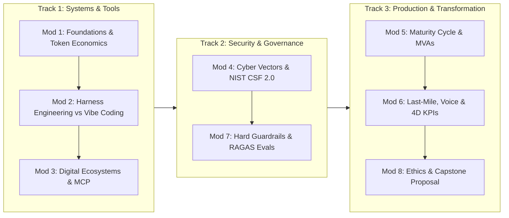

# MIT Applied Agentic AI: Master Curriculum & Educational Blueprint

> **Course Reference:** MIT Professional Education — *Applied Agentic AI for Organizational Transformation*  
> **Faculty Directors & Key Instructors:** Dr. Abel Sanchez, Dr. John Williams, Ali Tobah  
> **Target Audience:** Enterprise architects, AI engineers, product leaders, and students  
> **Core Objective:** Provide a rigorous, uncompromised knowledge base and syllabus structure for building an educational learning platform.

---

## Page 1: Foundations, Systems Architecture, and Digital Integration

### 1. Foundations of Generative & Agentic AI (Module 1)
- **Mechanics of Autonomy:** Transition from passive, stateless text generation (next-token prediction, zero-shot/few-shot prompts) to stateful, goal-directed agent loops: **Perceive $\rightarrow$ Reason $\rightarrow$ Act $\rightarrow$ Reflect (ReAct loop)**.
- **Core Architectures:** Self-attention transformers (encoder-decoder vs. decoder-only), diffusion models, multimodal ingest pipelines (vision, document parsing, audio spectrograms), Small Language Models (SLMs) vs. Frontier Large Language Models (LLMs).
- **Enterprise Cost Engineering:**
  - Token economics: Context-window overhead, input vs. output cost asymmetry, KV caching efficiencies.
  - Model tiering & routing: Dispatching deterministic classification/routing to inexpensive SLMs while reserving frontier models for multi-step reasoning.
  - Latency vs. precision vs. unit economics trade-offs.

### 2. Agentic Platforms & Engineering Paradigms (Module 2)
- **Vibe Coding vs. Harness Engineering:** 
  - *Vibe Coding (Karpathy):* Rapid exploratory prototyping using natural language code generation.
  - *Harness Engineering (MIT Standard):* Industrialized infrastructure encapsulating probabilistic LLM cores with deterministic boundary checks, strict schema validation, state machines, checkpointing, and regression suites.
- **Agent Topology:**
  - *Single-Agent:* Linear execution, lower latency, prone to context bloat and hallucination accumulation.
  - *Multi-Agent (Collaborative/Hierarchical):* Specialized role decomposition (Planner, Executor, Critic, Verifier), message passing protocols, shared blackboard memory.
- **Platform Taxonomy:** Visual automation (Zapier Central, n8n, Flowise) vs. Programmatic SDKs (LangGraph, AutoGen, CrewAI, native agent frameworks). Closed-source ecosystem lock-in vs. self-hosted open-source governance.

### 3. Digital Ecosystem Integration & Tool Orchestration (Module 3)
- **Tool Grounding:** Function calling, dynamic JSON schema registration, webhook endpoints, and asynchronous background tasks.
- **Model Context Protocol (MCP):** Anthropic’s open client-host-server specification decoupling LLMs from bespoke point-to-point API connectors, turning an $M \times N$ integration sprawl into a clean $1 \times N$ standard.
- **Legacy System Integration Realities:** Navigating brittle legacy ERP/CRM software, database connection pooling, idempotent write constraints, and API rate-limiting.
- **Algorithmic Catastrophe Mitigation:** Lessons from the *Knight Capital* collapse ($440M loss in 45 minutes) applied to autonomous agent swarms: mandatory hard circuit breakers, global kill-switches, rate-limited write privileges, and transactional rollback boundaries.

### 4. Cybersecurity, AI Perception Limits, and Cryptographic Trust (Module 4)
- **AI-Specific Threat Vectors:** Direct and indirect prompt injection (data poisoning via untrusted web/PDF inputs), jailbreak techniques, vector store contamination, agent impersonation, and package supply-chain attacks.
- **Perception Boundaries & Hallucinations:** Probabilistic token degradation, context loss over extended reasoning horizons, and deterministic verification methods (grounded retrieval, citation checking).
- **NIST Cybersecurity Framework 2.0 Mapping:**
  - *Identify:* Data asset classification, model supply chain risks.
  - *Protect:* Sandboxed tool execution, zero-trust network boundaries, PII redaction proxies.
  - *Detect:* Anomalous token consumption spikes, suspicious tool-call patterns, semantic drift.
  - *Respond & Recover:* Instant kill-switches, failover to deterministic fallback scripts, state rollback.
- **Cryptographic Trust:** Utilizing immutable audit trails and distributed ledger technology (blockchain) for tamper-evident provenance of autonomous machine decisions.

---

## Page 2: Scaling, Operational Last-Mile, Governance, and Ethics

### 5. Enterprise Scaling, Business Functions, and Architecture (Module 5)
- **The 5-Stage AI Maturity Cycle:** (1) Ad-hoc experimentation $\rightarrow$ (2) Proof-of-Concept (POC) $\rightarrow$ (3) Departmental Operationalization $\rightarrow$ (4) Enterprise Scaled Platform $\rightarrow$ (5) Autonomous Transformation.
- **The Minimum Viable Agent (MVA):** Building narrow, high-certainty agents solving single high-friction bottlenecks before attempting generalized multi-agent systems.
- **Functional Deployment Matrix:**
  - *Customer Support / Sales:* High-volume tier-1 resolution, sentiment adaptation, CRM bi-directional sync.
  - *Internal Operations / Supply Chain:* Automated invoice reconciliation, inventory exception routing.
  - *Healthcare & Highly Regulated Fields:* Clinical note summarization, strict PII/PHI redaction, HIPAA isolation.
  - *Autonomous Browser Agents:* Vision-driven DOM navigation, RPA replacement, and mitigation of visual spoofing/clickjacking.
- **Organizational Architecture:** Centralized AI Center of Excellence (CoE) for infrastructure/guardrails vs. Embedded/Federated functional teams for domain-specific prompt engineering and workflows.

### 6. The Last Mile — From Pilot to Practice (Module 6)
- **Overcoming "Pilot Purgatory":** Escaping the trap where 80%+ of successful POCs die before production due to undocumented edge cases, human operational resistance, lack of telemetry, and brittle error handling.
- **Real-Time Voice & Multimodal Agents:** Ultra-low latency voice pipelines (STT $\rightarrow$ LLM $\rightarrow$ TTS vs. native end-to-end audio models), WebSocket/WebRTC telephony integration, turn-taking dynamics, handling acoustic interruptions.
- **Organizational Change Management:** Overcoming the "replacement fear" through psychological safety, employee co-design, and the *ADKAR* change model.
- **The Phased Autonomy Model (Crawl-Walk-Run):**
  - *Crawl:* Agent as co-pilot (recommends actions; human performs all writes).
  - *Walk:* Agent executes low-risk actions with human exception review and manual sign-offs.
  - *Run:* Agent operates fully autonomously within strict risk corridors; human audits asynchronously.
- **The 4-Dimensional Agent KPI Framework:**
  1. *Technical Metrics:* Inference latency, tool error rate, uptime, context utilization.
  2. *Operational Metrics:* Task completion rate, deflection rate, first-contact resolution (FCR), human escalation rate.
  3. *Financial Metrics:* Cost per resolution, token ROI, net labor hours saved, infrastructure run-rate.
  4. *Adoption & Trust Metrics:* End-user CSAT/NPS, internal staff override frequency, sustained agent usage.

### 7. Governance, Compliance, and Automated Testing (Module 7)
- **Regulatory Frameworks:** 
  - *EU AI Act:* Strict risk classification (Unacceptable, High-Risk, Limited, Minimal) and mandatory transparency obligations.
  - *GDPR & CCPA:* The critical tension between the "Right to be Forgotten" (Article 17) and irreversible vector database embeddings; restrictions on automated profiling (Article 22).
- **Guardrail Architecture (Dual-Layer Defense):**
  - *Soft Guardrails:* System prompts, dynamic context injection, Constitutional AI checks (probabilistic, non-guaranteed).
  - *Hard Guardrails:* Deterministic pre/post-execution interceptors, regex/PII masking proxies, schema enforcement, NeMo Guardrails, API permission scopes (unbypassable).
- **Agent Testing & Evaluation (CI/CD for AI):**
  - Unit testing individual tool calls vs. end-to-end multi-turn trajectory evaluation.
  - *Automated Evals (RAGAS framework):* Faithfulness, Answer Relevancy, Context Recall, Context Precision.
  - Curated Golden Datasets, automated red-teaming, and LLM-as-a-Judge with calibrated scoring rubrics.
- **Auditability & Observability:** Immutably logging every prompt, raw input, model token trace, tool payload, decision state, and human intervention.

### 8. Ethics, Enterprise Transformation, and Capstone Synthesis (Module 8)
- **Operationalizing AI Ethics:**
  - *Workforce Transformation:* Managing job transition and task evolution using the "Mailroom Metaphor" (automating mechanical routing to elevate human strategic work).
  - *Algorithmic Fairness & Bias:* Continuous auditing of demographic, cultural, and socioeconomic skew in model outputs.
  - *Accountability & Legal Liability:* Legal liability remains strictly human; an agent cannot be held legally or fiduciary accountable.
- **The Enterprise Capability Gap:** Bridging executive strategic vision and ground-level technical engineering readiness.
- **The Capstone Architecture:** Building the production adoption blueprint combining technical stack selection, cost modeling, NIST security posture, Crawl-Walk-Run rollout, governance guardrails, and executive business KPIs.

---

## Section 3: Educational Website Pedagogical Track Architecture

To translate this 2-page curriculum into an engaging, high-conversion educational platform, structure the site around three progressive tracks:

### Proposed Course Site Navigation & Module Structure
1. **Interactive Concept:** A 5-minute interactive visualizer (e.g., token calculator, ReAct state-machine simulator, or guardrail comparison).
2. **Failure Post-Mortem:** A real-world cautionary case study (e.g., Knight Capital, vector DB GDPR leaks, pilot purgatory stalls).
3. **Engineering Lab / Hands-on:**
   - *Lab 1:* Cost router script (dispatching prompts between SLM and Frontier models).
   - *Lab 2:* Building an MCP server for tool integration.
   - *Lab 3:* Implementing hard schema guardrails and PII redaction.
   - *Lab 4:* Setting up automated trajectory evaluation with RAGAS and Golden Datasets.
4. **Executive Blueprint Template:** Downloadable board-level templates (Security memo, 4D KPI scorecard, Capstone adoption plan).
