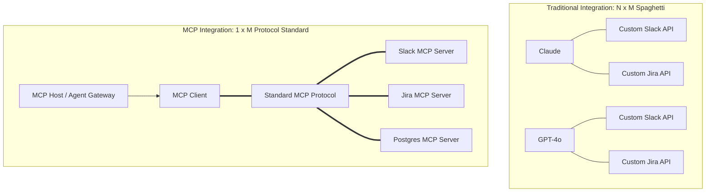
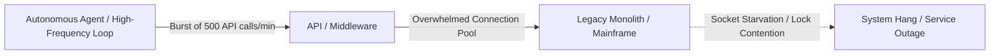

# Module 3 Complements: Insights from MIT Faculty & Instructors

## Executive Summary & Scope

**Module 3: Connecting Agents to Digital Ecosystems** tackles the most difficult engineering hurdle in enterprise AI adoption: transitioning from standalone text generation to systems that directly interact with existing corporate software. While the core Canvas module introduces tools (Slack, Notion, Discord), automation utilities (Zapier, n8n), and a high-level overview of Anthropic's **Model Context Protocol (MCP)**, the live sessions probed **the deep integration bottlenecks, legacy infrastructure traps, and protocol edge cases**.

Across 21 live office hours led by Luca Cosentino, Ali Tobah, Arnold Schiemann, Daniel Mastropietro, and Lee Bogner, the curriculum shifted from consumer-grade workflow automations to **hardened enterprise integration patterns, rate-limiting realities, and catastrophic risk controls**.

```
+-----------------------------------------------------------------------------------------+
|                                    MODULE 3 DELTA                                       |
+------------------------------------+----------------------------------------------------+
| In Core Canvas Module              | Added in Faculty & Instructor Sessions             |
+------------------------------------+----------------------------------------------------+
| High-level MCP definition          | Client-Host-Server topology & protocol edge cases  |
| Simple Zapier vs. n8n demos        | 4-Tier Automation Spectrum (No-Code to Full-Code)  |
| Spotify consumer playlist example  | Enterprise translation: ERP/CRM intent execution   |
| Basic API integration concepts     | Legacy monolith bottlenecks & connection pooling   |
| Abstract workflow definitions      | "Automated systems scale errors with efficiency"   |
| Conceptual guardrails              | The Knight Capital disaster case study ($440M loss)|
| General assignment instructions    | Blueprint state-machine design & grading pitfalls  |
+------------------------------------+----------------------------------------------------+
```

---

## Model Context Protocol (MCP): The Architectural Paradigm Shift

### 1. The $N \times M$ Integration Problem vs. Universal Protocol
*(Contributed by Luca Cosentino & Ali Tobah)*

Before MCP, connecting $N$ AI models to $M$ enterprise tools required $N \times M$ bespoke API wrappers, bespoke JSON schemas, and continuous maintenance as API endpoints evolved.

* **The MCP Standard:** Created by Anthropic and adopted as an open-source standard, MCP decouples the model from the tools through a client-host-server architecture:
  * **MCP Host:** The runtime environment where the AI operates (e.g., Claude Desktop, an enterprise AI gateway, or an IDE).
  * **MCP Client:** The internal protocol adapter inside the model application that maintains a 1:1 connection with servers.
  * **MCP Server:** A lightweight, specialized program that exposes local or remote resources (databases, APIs, file systems, GitHub repositories) via a standardized protocol.



### 2. The Shift from UI-Based Navigation to Intent-Based Execution
*(Contributed by Luca Cosentino)*

Traditional enterprise software requires human workers to manually traverse graphical user interfaces (GUIs)—clicking through paginated tables, filtering columns, formatting cells, and copying records across tabs.
* **The Spotify Microcosm:** In the core module, Spotify demonstrates querying an LLM for historical hit songs and programmatically generating a playlist.
* **The Enterprise Macrocosm:** In business applications, MCP transforms enterprise operations from *UI management* to *intent execution*:
  * *Legacy Workflow:* An operations analyst opens SAP, navigates three sub-menus, pulls inventory for SKU-409, downloads a CSV, cross-references Salesforce for open orders, and manually issues an expedited shipment flag.
  * *MCP Workflow:* The user instructs: *"Audit open orders for SKU-409 against live warehouse stock; if warehouse inventory is below reorder threshold, trigger an expedited purchase order and notify account managers on Slack."* The MCP Host orchestrates queries across SAP, Salesforce, and Slack servers through a single context boundary without touching a GUI.

### 3. Critical Production Edge Cases of MCP
*(Contributed by Ali Tobah & Arnold Schiemann)*

While MCP dramatically simplifies development, instructors warned of critical architectural edge cases in production:
1. **Schema Bloat & Context Exhaustion:** Every MCP server advertises its available tools and resource templates. If an agent connects to 10 enterprise MCP servers exposing 100 tools, the injected tool schemas consume 10,000+ tokens *before the user even types a prompt*.
2. **Authentication Pass-Through:** In multi-tenant enterprise architectures, an agent must not execute actions under a generic service account. MCP implementations must support user-delegated OAuth token pass-through so row-level access control (RLS) is preserved.
3. **Connection State & Latency Overhead:** MCP relies on JSON-RPC 2.0 over standard I/O (stdio) or Server-Sent Events (SSE). Distributed SSE connections across firewalls can introduce socket timeouts, requiring resilient heartbeat and reconnection middleware.

---

## Integrating with Legacy Systems: The Unspoken Realities

### 1. The Three Structural Monolith Barriers
*(Contributed by Luca Cosentino & Arnold Schiemann)*

Most enterprises cannot discard their existing architecture. Instructors detailed why integrating agents into legacy systems (AS/400, on-premise SAP, Oracle 11g, legacy banking cores) is fundamentally hazardous:



1. **Monolithic Architecture Constraints:** Legacy platforms were engineered with tightly coupled user interfaces, stored procedures, and database storage. They lack modular REST or GraphQL interfaces, forcing teams to build complex intermediary middleware.
2. **Schema Inconsistency & Data Drift:** Customer records across multiple business units often utilize conflicting keys, truncated string lengths, or undocumented numeric codes. An LLM reasoning over non-standardized legacy fields will hallucinate invalid business decisions.
3. **Compute & Connection Starvation:** Legacy enterprise applications were sized for *human-speed interaction* (e.g., an employee clicking a form once every 30 seconds). An autonomous agent loop executing 500 requests per minute during a reconciliation process will exhaust database connection pools, lock transactional tables, and trigger enterprise-wide outages.

### 2. UI Automation: Computer-Use Agents as the Last Resort
*(Contributed by Arnold Schiemann)*

For ancient systems where exposing an API is commercially or technically impossible, instructors highlighted the emergence of **Computer-Use Agents** (e.g., vision-based agents operating virtual desktops).
* **When to Use:** Strictly reserved for air-gapped or closed legacy terminals (e.g., legacy mainframe green screens, desktop ERPs lacking SDKs).
* **The Trade-off:** High latency (5–10 seconds per screen interaction), brittle screen-resolution dependencies, and massive token costs due to continuous screenshot inference.

---

## The Automation Tool Spectrum

To guide assignment submissions, Luca Cosentino codified the four primary automation approaches into an actionable spectrum:

| Tool Tier | Technical Complexity | Primary Strengths | Critical Limitations | Enterprise Use Case |
| :--- | :--- | :--- | :--- | :--- |
| **Zapier (No-Code)** | Zero code (Point & click) | Rapid 5-minute setup; 6,000+ commercial SaaS connectors. | Rigid trigger-action; zero conditional branching or LLM reasoning. | Simple lead routing: Typeform $\rightarrow$ HubSpot $\rightarrow$ Slack notification. |
| **n8n / Make (Low-Code)** | Low (Visual logic & JavaScript expressions) | Visual flowcharts; handles complex branching, loops, and self-hosted privacy. | Complex state debugging; version control in Git is difficult. | Multi-system data reconciliation; event-driven alerts with self-hosting. |
| **LangChain / LangGraph (Pro-Code)** | High (Python / TypeScript) | Cyclic state graphs; long-term memory; multi-agent coordination; custom tools. | High development overhead; requires dedicated software engineering team. | Autonomous financial compliance audit agents; dynamic RAG researchers. |
| **Custom Python (Full-Code)** | Very High (Systems Engineering) | Absolute flexibility; zero third-party vendor lock-in; optimized latency. | Highest CapEx; requires ongoing maintenance, testing, and infrastructure. | Proprietary algorithmic execution; ultra-low-latency high-volume pipeline. |

---

## Algorithmic Catastrophes: The Knight Capital Case Study

*(Contributed by Ali Tobah)*

A recurring warning delivered across Module 3 office hours is that **automated systems scale errors with the same mathematical efficiency that they scale productivity**.

### The 2012 Knight Capital Group Precedent
* **The Event:** In August 2012, Knight Capital Group deployed an automated trading algorithm with an undocumented legacy configuration flag.
* **The Failure Loop:** Upon market open, the automated system entered an infinite, high-speed execution loop—buying high and selling low across millions of shares without human intervention.
* **The Damage:** The system executed **4 million trades in 45 minutes**, losing **$440 million** ($10 million per minute) and bankrupting the firm before engineers could locate and terminate the process.
* **Direct Relevance to AI Agents:** Autonomous agents armed with write-access APIs (e.g., updating database prices, issuing refunds, modifying inventory, sending mass emails) can trigger catastrophic cascades if an unconstrained reasoning loop misinterprets an edge condition.

### Mandatory Enterprise Safeguards
1. **Transaction Velocity Throttling:** Programmatic rate limits on state-changing API operations (e.g., an agent may issue refunds up to $1,000/hour; exceeding this threshold triggers an automatic freeze and human alert).
2. **Financial / Impact Ceilings:** Strict value ceilings on write tools. Transactions exceeding a predefined dollar value require cryptographically signed human approval.
3. **The Out-of-Band Kill Switch:** An independent, hardware-level or cloud-network kill switch that immediately revokes an agent's OAuth tokens and isolates its execution sandbox without requiring access to the agent's internal control loop.

---

## Instructor Perspectives & Office Hour Debates

* **Luca Cosentino:** *"A generative AI chatbot is like a recorded playlist: it plays what was planned. An agentic system is like a live jazz band: it reads the room, improvises across instruments, and reacts to live feedback. But if your drummer loses tempo, the entire performance collapses unless there is a conductor."*
* **Ali Tobah:** *"Do not confuse integration with access. Just because you can connect an agent to an enterprise database does not mean you should grant it unrestricted SQL permissions. Implement read-only replicas and parameterized stored procedures."*
* **Arnold Schiemann:** *"When designing telephony or voice integrations, latency is your mortal enemy. If an agent takes 1.5 seconds to acknowledge a spoken sentence, the customer will speak over it, causing audio packet collisions and conversational deadlock."*
* **Lee Bogner:** *"The biggest failure in Assignment 3 is students designing an agent that lives in a vacuum. Your architecture diagram must clearly show the API gateways, authentication layers, and error recovery queues."*

---

## Assignment 3.1 & Capstone Guidance

### Navigating Assignment 3.1
Assignment 3.1 requires students to design an integration architecture connecting an AI agent into an existing organizational workflow. Facilitators highlighted the criteria separating a passing grade from a revision request:

1. **Map the Middleware Layer:** Do not draw a direct arrow from "LLM" to "Legacy ERP." You must illustrate the middleware, API gateway, and data validation layers.
2. **Explicit Error & Fallback Paths:** What happens when an external SaaS endpoint returns a `503 Service Unavailable` or `429 Too Many Requests`? Your blueprint must depict retry queues, exponential backoff, and human escalation fallback paths.
3. **Security & Permission Boundaries:** Specify the principle of least privilege. The agent should only hold the minimum OAuth scopes necessary to fulfill its designated task.

### Capstone Project Integration
For the Capstone adoption plan:
* Module 3 provides the core technical substance for **Section 2 (Technology Choice & System Integration)** and **Section 6 (Scaling Architecture)**.
* For Remi's Capstone use case (**Olivia on Salesforce Agentforce**), Module 3 highlights why Agentforce is structurally advantageous: it replaces custom API middleware with Salesforce's native Data Cloud, Einstein Trust Layer, and pre-built standard objects, eliminating external network latency and custom OAuth maintenance.

---

## Key Synthesis Checklist for Module 3

- [ ] **Protocol Standardization:** Have you evaluated whether exposing tools via MCP reduces your long-term integration and maintenance overhead?
- [ ] **Legacy Protection:** Are your legacy databases protected from high-frequency agent swarms via connection pooling, caching, and rate limiting?
- [ ] **Circuit Breakers & Kill Switches:** Does your architecture feature out-of-band kill switches and transactional velocity limits to prevent Knight-Capital-style cascade failures?
- [ ] **Least-Privilege Scopes:** Are tool permissions restricted to parameterized actions rather than raw, unvalidated read/write database access?
- [ ] **Graceful Degradation:** When third-party APIs fail or time out, does the agent degrade gracefully and notify human operators without crashing the session?
