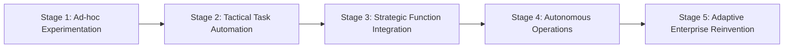

# Module 5 Complements: Insights from MIT Faculty & Instructors

## Executive Summary & Scope

**Module 5: AI Agents by Business Function** marks the midpoint of the course, shifting focus from technical building blocks to enterprise implementation. In the static Canvas modules, the material surveys functional domains (marketing, sales, human resources, finance, supply chain) and presents isolated use cases (e.g., automated email drafting, customer segmentation).

However, during the **19 live sessions and office hours** conducted by Luca Cosentino, Arnold Schiemann, Simon Barna, Ali Tobah, and Lee Bogner, instructors challenged students to think like Chief AI Officers. The discussion centered on **how to move from isolated tactical toys to systemic value creation, managing multi-agent pipeline fragility, and navigating high-risk regulatory classifications by department**.

```
+-----------------------------------------------------------------------------------------+
|                                    MODULE 5 DELTA                                       |
+------------------------------------+----------------------------------------------------+
| In Core Canvas Module              | Added in Faculty & Instructor Sessions             |
+------------------------------------+----------------------------------------------------+
| Departmental use case surveys      | Dr. Sanchez's 5-Stage AI Maturity Cycle            |
| Isolated prompt-based tasks        | Multi-agent YAML workflow architectures            |
| Generic productivity gains         | Value formula: Revenue Expansion vs. Cost Reduction|
| Conceptual functional benefits     | Multi-agent prompt coupling fragility ("Chain Jam")|
| General HR screening examples      | EU AI Act Annex III high-risk legal liabilities    |
| Standard assignment template       | Minimum Viable Agent (MVA) & Lean Kaizen deployment|
+------------------------------------+----------------------------------------------------+
```

---

## Strategic Adoption: The 5-Stage AI Maturity Cycle

*(Developed by Dr. Abel Sanchez & synthesized by Luca Cosentino)*

A recurring theme across Module 5 office hours is that 80% of corporate AI initiatives stall because leadership fails to recognize their current organizational maturity stage:



1. **Stage 1: Ad-hoc Experimentation (Shadow AI):** Individual employees independently experiment with ChatGPT or Claude to draft emails and write code.
   * *Risk:* Massive intellectual property and customer data leakage into public consumer LLMs; zero institutional learning.
2. **Stage 2: Tactical Task Automation:** Departments commission isolated point solutions (e.g., an IT helpdesk chatbot or automated document summarizer).
   * *Limitation:* Generates localized efficiency but creates SaaS tool sprawl and disjointed data silos.
3. **Stage 3: Strategic Function Integration:** AI agents are formally integrated into departmental data backbones (e.g., Salesforce, SAP, Workday) with defined business KPIs, deterministic guardrails, and role-based permissions.
4. **Stage 4: Autonomous Operations (Cross-Functional Orchestration):** Multi-agent systems execute closed-loop workflows across departments without manual handoffs (e.g., an automated contract review agent notifies procurement, provisions cloud instances, and updates accounting). Human review is reserved for exception handling.
5. **Stage 5: Adaptive Enterprise Reinvention:** Business models, pricing strategies, and customer experiences are natively structured around agentic workflows, fundamentally reshaping company margins and operating leverage.

---

## Function-by-Function Deployment: Realities & Regulatory Hazards

Facilitators provided an unvarnished audit of where agentic AI creates immediate enterprise ROI versus where it introduces severe regulatory or operational liabilities:

### 1. Marketing & Growth: Beyond Generative Copy
* **The Low-Value Trap:** Using an agent simply to write generic SEO articles or marketing copy flood the market with bland text that damages brand equity.
* **The High-ROI Pattern:** Closed-loop campaign orchestration:
  * Ingesting live ad analytics (Meta, Google Ads) $\rightarrow$ detecting performance decay $\rightarrow$ autonomously generating multivariate creative variations $\rightarrow$ reallocating budget toward top-converting segments in real time.

### 2. Sales & Business Development: Contextual Account Intelligence
* **The High-ROI Pattern:** Eliminating administrative CRM data entry.
  * Ingesting meeting transcripts (Zoom/Teams via Whisper) $\rightarrow$ extracting buyer objections and competitor mentions $\rightarrow$ autonomously populating Salesforce opportunity fields $\rightarrow$ drafting customized, technical follow-up proposals for human sales rep approval.

### 3. Supply Chain & Procurement: Predictive Disruption Mitigation
* **The High-ROI Pattern:** Integrating agents directly with inventory management and external telematics (weather, shipping port congestion, geopolitical alerts):
  * Detecting weather-induced rail delays $\rightarrow$ autonomously querying secondary suppliers via API $\rightarrow$ calculating shipping price vs. factory downtime penalties $\rightarrow$ presenting a pre-negotiated purchase order to the procurement director.

### 4. Human Resources: The High-Risk Regulatory Minefield
*(Contributed by Luca Cosentino & Simon Barna)*
* **The Severe Risk:** Deploying agents to autonomously filter resumes, conduct initial video interview evaluations, or score employee performance.
* **Legal Exposure:** Under the **EU AI Act (Annex III)**, AI systems used in recruitment, hiring, and promotion are formally classified as **High-Risk AI Systems**. They require mandatory bias audits, human oversight logging, technical documentation, and explainability guarantees. Failure to comply incurs fines up to **€35 million or 7% of global annual turnover**.
* **The Permissible Zone:** Deploying internal HR FAQ agents for employee benefits, internal policy navigation, and automated onboarding scheduling (low risk, high administrative relief).

---

## Multi-Agent Architecture: The Fragility of Prompt Chains

*(Contributed by Arnold Schiemann)*

When enterprise workflows move from a single agent to a multi-agent system (e.g., Research Agent $\rightarrow$ Analysis Agent $\rightarrow$ Drafting Agent $\rightarrow$ Compliance Agent), instructors warned of a phenomenon known as **Prompt Coupling Fragility** (or "Chain Jam"):

```mermaid
flowchart TD
    subgraph Fragile Natural Language Chain
        A1[Agent 1: Research] -->|Unstructured English Prose| A2[Agent 2: Synthesis]
        A2 -->|Unstructured English Prose| A3[Agent 3: Financial Modeler]
        A3 -.->|Parse Failure: Agent 2 altered bullet formatting| Crash[Pipeline Failure / Exception]
    end
    subgraph Hardened Enterprise Contract Chain
        B1[Agent 1: Research] -->|Pydantic JSON Schema Contract| B2[Agent 2: Synthesis]
        B2 -->|Pydantic JSON Schema Contract| B3[Agent 3: Financial Modeler]
        B3 --> Success[Deterministic Successful Execution]
    end
```



### The "If I Change This Prompt, Three Agents Break" Problem
In production systems, when agents pass raw conversational natural language to downstream agents, subtle variations in wording or formatting cause catastrophic cascading failures:
* *Real Production Case:* In a 6-agent research pipeline, tweaking Agent 1's system prompt to make its summaries "more concise" caused Agent 3 (the data extractor) to fail because expected key phrases were omitted.
* **The Production Fix (Contract-Driven Agent Interfaces):**
  1. **Strict Intermediate Schemas:** Agents must *never* communicate with other agents via free-form natural language. Handoffs must be enforced using strict JSON schemas (e.g., Pydantic models).
  2. **Model Tiering by Stage:** In complex production pipelines (such as Arnold Schiemann's research workflows), model compute must be right-sized per stage:
     * *Data Parsing / Formatting:* Claude Haiku or GPT-4o-mini (168 pipeline steps).
     * *Domain Synthesis:* Claude Sonnet (105 pipeline steps).
     * *Executive Review & Ambiguity Resolution:* Claude Opus or o1 (6 pipeline steps).
  3. **Immutable Step State Logging:** Every intermediate step must output an immutable state file with its full evidence and token telemetry to allow exact replay during debugging.

---

## Lean Deployment: The Minimum Viable Agent (MVA)

*(Contributed by Simon Barna)*

Simon Barna linked agentic deployment to the **Toyota Production System (TPS)**, Kaizen (continuous improvement), and Lean Startup methodologies:

* **The Shareholder Value Equation:** An agentic workflow is only justifiable if it directly impacts one of two operational metrics:
  $$\Delta \text{Shareholder Value} = \Delta \text{Revenue Expansion} + \Delta \text{Cost Reduction}$$
* **Minimizing the Cost of Learning:** Do not spend six months building an all-encompassing multi-agent system. Build a **Minimum Viable Agent (MVA)** that handles a single, repetitive 5-minute task with human-in-the-loop validation.
* **Measure and Eliminate "Muda" (Waste):** Track human intervention rates. If the human reviewer overrides the agent's output more than 20% of the time, the process lacks clean input data or the task is too ambiguous for the current model tier.

---

## Instructor Perspectives & Office Hour Debates

* **Luca Cosentino:** *"The central question for Module 5 is moving from the abstract to the operational. Anyone can say 'AI can help marketing.' The real test is defining the exact inputs, the state machine, the tool calls, and the human oversight gates."*
* **Arnold Schiemann:** *"Do not hardcode prompts inside application code. Manage prompts, schemas, and routing logic as versioned configuration files (YAML/JSON) with automated CI/CD regression tests."*
* **Simon Barna:** *"Start with early advocates inside your business units. If you try to force an AI workflow onto a cynical department that fears job replacement, they will actively feed the agent bad data to prove it fails."*
* **Ali Tobah:** *"In Module 5, ROI must include governance. An agent that saves 10 hours a week but creates an uninspected data breach creates net negative enterprise value."*

---

## Assignment 5.1 & Capstone Guidance

### Navigating Assignment 5.1
Assignment 5.1 requires students to propose a concrete 200–300 word AI integration plan for one specific function in their organization:

1. **Avoid Generic Summaries:** Stating "an AI agent will help HR answer questions" will result in a 0. Specify:
   * The exact data sources accessed (e.g., internal Confluence wiki, Workday leave policies).
   * The platform architecture (e.g., low-code vs. custom code).
   * The specific measurable KPI (e.g., reducing Tier-1 HR tickets by 45% within 90 days).
2. **Explicit Human-in-the-Loop Boundaries:** Clearly define what the agent cannot do autonomously (e.g., the agent drafts performance improvement plans, but HR directors must review and sign off).

### Capstone Project Integration
* Module 5 provides the operational backbone for **Section 1 (Context & Functional Domain)**, **Section 5 (Change Management & Training)**, and **Section 6 (Scaling Architecture)**.
* For Remi's Capstone use case (**Olivia on Salesforce Agentforce**):
  * Functional Domain: **Merchant Operations / Partner Success** for European food-delivery platforms.
  * The MVA: Proactively messaging restaurant partners via WhatsApp to suggest extended opening hours during high-demand events (football matches, rainstorms) and programmatically updating the backend POS upon merchant confirmation.

---

## Key Synthesis Checklist for Module 5

- [ ] **Maturity Alignment:** Does your proposed agent target your organization's actual AI maturity stage, rather than skipping directly to unmanaged autonomous operations?
- [ ] **Value Equation:** Is your business case anchored in concrete revenue expansion or direct operational cost elimination?
- [ ] **Contract-Driven Handoffs:** Do multi-agent workflows communicate via structured JSON/Pydantic schemas rather than brittle natural language?
- [ ] **Regulatory Risk Classification:** If deploying in HR, credit scoring, or customer profiling, have you accounted for EU AI Act high-risk compliance burdens?
- [ ] **Model Right-Sizing by Step:** Have you assigned lightweight models to data formatting steps and reserved frontier models for high-ambiguity synthesis?
