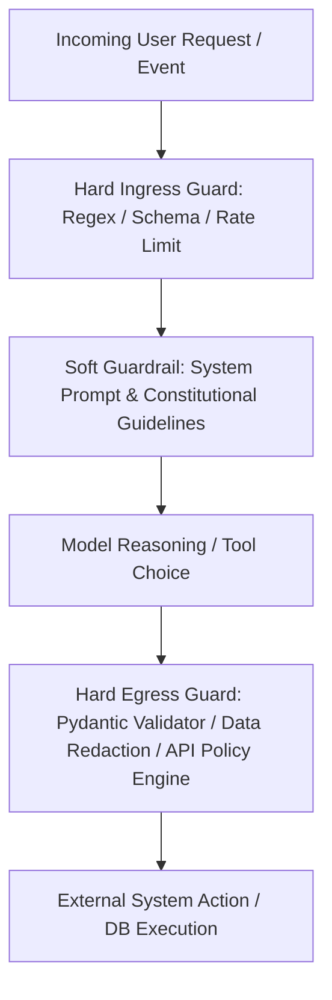
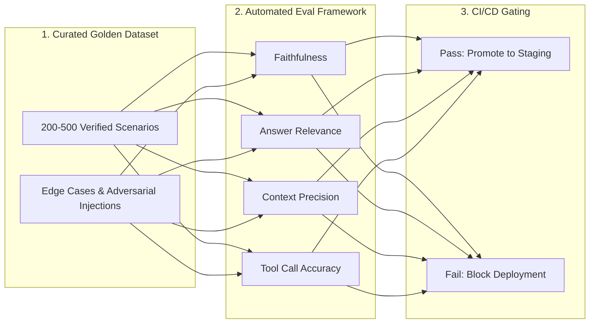

# Module 7 Complements: Insights from MIT Faculty & Instructors

## Executive Summary & Scope

**Module 7: Governance, Compliance, and Agent Testing** addresses the institutional oversight required to run autonomous systems safely within legal and societal boundaries. In the core Canvas modules, the curriculum introduces privacy regulations (GDPR, CCPA, HIPAA) and standard testing methodologies (unit tests, integration tests, red-teaming).

However, across the **24 live sessions and office hours** conducted by Ali Tobah, Simon Barna, Daniel Mastropietro, and Lee Bogner, the focus shifted to **operational auditability, the engineering distinction between hard and soft guardrails, automated evaluation pipelines (RAGAS), and enterprise compliance readiness**.

```
+-----------------------------------------------------------------------------------------+
|                                    MODULE 7 DELTA                                       |
+------------------------------------+----------------------------------------------------+
| In Core Canvas Module              | Added in Faculty & Instructor Sessions             |
+------------------------------------+----------------------------------------------------+
| High-level privacy legal summaries | "Compliance means being able to prove it" mandate  |
| Conceptual guardrail definitions   | Hard (deterministic) vs. Soft (LLM) Guardrail laws |
| Basic testing concepts             | Automated eval engineering: Golden Datasets & RAGAS|
| General compliance policies        | GDPR Article 17 "Right to be Forgotten" in Vectors |
| Theoretical governance models      | Audit trail taxonomy: Logging human override events|
| High-level red-teaming mentions    | Risk vs. Speed quadrants for guardrail latency     |
| Standard assignment rubric         | Enterprise compliance checklists for the Capstone  |
+------------------------------------+----------------------------------------------------+
```

---

## Governance Architecture: Hard vs. Soft Guardrails

*(Contributed by Ali Tobah)*

A critical failure pattern in enterprise AI governance is relying on prompts as the primary security and compliance boundary:

> **The First Law of AI Governance:** *"The system prompt is a SOFT guardrail, not a hard one. A soft guardrail is probabilistic and can be bypassed. A hard guardrail is deterministic, mathematical, and enforced outside the model context."*



### 1. Soft Guardrails (Probabilistic & Advisory)
* **Mechanisms:** System prompt instructions (*"Do not reveal customer PII"*, *"Never discuss competitor pricing"*), few-shot examples, and constitutional prompting.
* **Vulnerability:** Vulnerable to multi-turn social engineering, adversarial jailbreaks, and linguistic misinterpretation.
* **Appropriate Role:** Shaping conversational tone, guiding persona, and providing contextual guidelines for routine generation.

### 2. Hard Guardrails (Deterministic & Inflexible)
* **Mechanisms:**
  * **Ingress API Firewalls:** Rejecting requests containing known SQL injection signatures, unapproved character sets, or velocity violations before the LLM is invoked.
  * **Parameter Schema Enforcement:** Forcing tool calls through strict JSON schemas (e.g., Pydantic). If an agent attempts to emit a tool argument with an unauthorized data type or out-of-range value, the execution halts at the code level.
  * **Programmatic PII Masking:** Dynamic redaction engines (e.g., Microsoft Presidio, AWS Comprehend) stripping email addresses, phone numbers, and Social Security numbers *before* prompts exit the VPC.
  * **Policy Enforcement Points (PEPs):** An independent middleware proxy that verifies whether the agent's OAuth scope permits writing to the targeted database row.

---

## The Audit Trail: "Compliance Means Being Able to Prove It"

*(Contributed by Ali Tobah & Simon Barna)*

Instructors emphasized that regulatory bodies (FTC, European Data Protection Board, SEC, HHS) do not evaluate an organization's stated intentions; they evaluate **the immutable evidence an organization can produce during an audit**.

### The Audit Readiness Test
> *"If your organization received a formal regulatory subpoena or compliance audit tomorrow morning regarding an automated decision made by your AI agent, what concrete evidence could you produce by 2:00 PM?"*

### Taxonomy of an Enterprise AI Audit Record
To satisfy GDPR Article 30 and EU AI Act Article 12, every transaction must log an immutable, cryptographically chained record containing:

| Telemetry Field | Operational Purpose | Regulatory Mandate |
| :--- | :--- | :--- |
| **Timestamp & Session UUID** | Pinpoints exact millisecond of execution. | All frameworks |
| **User Identity & Auth Scope** | Verifies the initiating identity and organizational permissions. | ISO/IEC 42001, SOC 2 |
| **Input Payload (Sanitized)** | The exact prompt and retrieved context injected into the context window. | GDPR Art. 15 (Right of Access) |
| **Model Metadata** | Exact model version, temperature, and system prompt hash. | EU AI Act Art. 12 (Traceability) |
| **Tool Execution Log** | Exact API called, input parameters passed, and raw response received. | NIST CSF (Detect/Protect) |
| **Guardrail Decision Flag** | Documents whether safety filters were triggered or modified output. | AI Safety Compliance |
| **Human Override Event** | Explicit log if a human operator intervened, rejected, or edited output. | EU AI Act Art. 14 (Oversight) |

> **Key Governance Principle:** *The decision of a human operator to override an AI agent is itself an auditable event. If an employee routinely overrides safety warnings to speed up their workflow, the organization faces vicarious liability.*

---

## Data Privacy Traps: GDPR Article 17 in Vector Embeddings

*(Contributed by Simon Barna & Luca Cosentino)*

While the Canvas readings summarize GDPR, live sessions surfaced the technical collision between privacy regulations and vector search architectures:

```
+-----------------------------------------------------------------------------------------+
|                                    GDPR vs. VECTOR RAG                                  |
+------------------------------------+----------------------------------------------------+
| GDPR Article 17 (Right to Erasure) | Vector Store Reality (Pinecone, Qdrant, Milvus)    |
+------------------------------------+----------------------------------------------------+
| A user demands immediate and       | Embeddings are high-dimensional mathematical       |
| permanent deletion of all personal | representations stored in immutable index chunks.  |
| data from company systems.         | Purging a single vector requires index re-indexing.|
+------------------------------------+----------------------------------------------------+
```

### The Architectural Solution: Decoupled Vector Storage
1. **Never Store Raw PII in Vector Metadata:** Vector embeddings should point to anonymized document IDs, not raw customer records.
2. **The Cryptographic Shredding Pattern:** Encrypt user document chunks with a unique customer-specific encryption key before generating vector metadata. When a customer exercises their Right to Erasure under GDPR Art. 17, delete the customer's encryption key. Even though the vector embedding remains in the index, the associated text chunk becomes mathematically unrecoverable.

---

## Automated Agent Testing: From Unit Tests to RAGAS

*(Contributed by Ali Tobah & Arnold Schiemann)*

In traditional software, testing asserts deterministic boolean conditions (`assert calculate_tax(100) == 10`). In agentic systems, outputs are probabilistic. Facilitators detailed the modern testing stack:



### 1. The Curation of Golden Datasets
Organizations must build a version-controlled **Golden Dataset** containing 200–500 validated input-output pairs covering:
* **Nominal Scenarios (60%):** Standard, well-formatted business requests.
* **Edge & Boundary Cases (25%):** Missing parameters, ambiguous inputs, conflicting business rules.
* **Adversarial Red-Team Probes (15%):** Prompt injections, roleplay attacks, attempts to extract system instructions.

### 2. The RAGAS Evaluation Framework
For agents utilizing Retrieval-Augmented Generation (RAG), facilitators recommended four core quantitative metrics:
* **Faithfulness:** Does the generated response rely *strictly* on the retrieved context, or did the model hallucinate outside information?
  $$\text{Faithfulness} = \frac{|\text{Claims in Output Supported by Context}|}{|\text{Total Claims in Output}|}$$
* **Answer Relevance:** Does the output directly answer the user's initial question without irrelevant conversational padding?
* **Context Precision:** Did the retrieval engine surface the exact relevant chunk at the top of the context window ($K=1$)?
* **Context Recall:** Did the retrieval engine surface all background documents necessary to answer the question?

---

## Instructor Perspectives & Debates

* **Ali Tobah:** *"Do not outsource your compliance to OpenAI or Anthropic. Signing an enterprise SLA does not transfer your statutory GDPR or HIPAA liability. The model provider is a data processor; you are the data controller."*
* **Simon Barna:** *"Decentralize routine operational decisions to autonomous agents, but fiercely centralize strategic and risk policies. If an agent must make an ethical trade-off, it must escalate to a human committee."*
* **Arnold Schiemann:** *"Testing an agent once before launch is meaningless. You must implement continuous synthetic evaluations in your CI/CD pipeline. Every time an API endpoint updates or a model provider releases a patch, your automated test suite must run."*
* **Lee Bogner:** *"Governance is not an IT roadblock; it is the accelerator that gives executive leadership the confidence to fund and scale your project."*

---

## Assignment 7.1 & Capstone Guidance

### Navigating Assignment 7.1
Assignment 7.1 requires designing a testing, evaluation, and compliance governance framework for an organizational AI agent:

1. **Avoid Soft Testing Generalities:** Stating "we will test the agent with human reviewers" will earn a 0. Specify:
   * The size and composition of your Golden Dataset.
   * The automated evaluation framework utilized (e.g., RAGAS, DeepEval, Arize Phoenix).
   * The quantitative threshold for production promotion (e.g., Faithfulness $\ge 0.95$, Tool Execution Schema Errors $= 0\%$).
2. **Explicit Regulatory Alignment:** Identify which specific legislation governs your use case (e.g., GDPR Art. 6 lawful basis for processing, EU AI Act risk tier, or HIPAA Business Associate Agreement provisions).

### Capstone Project Integration
* Module 7 forms **Section 4 (Security, Safety & Testing Plan)** and **Section 7 (Governance, Ethics & Compliance)** of the Capstone document.
* For Remi's Capstone use case (**Olivia on Salesforce Agentforce**):
  * **GDPR Compliance in NL & DE:** Detail how Olivia handles restaurant partner personal data (owner phone numbers, business addresses) across WhatsApp. Emphasize WhatsApp Business API opt-in requirements and Salesforce Data Cloud consent flags.
  * **Einstein Trust Layer Integration:** Highlight Salesforce's zero-data-retention architecture with third-party LLMs and automated toxicity masking.
  * **Evaluation & Testing:** Specify a pre-deployment Golden Dataset of 300 multilingual restaurant interactions (Dutch, German, English) testing dialect nuances, opening hour syntax, and adversarial injection attempts.

---

## Key Synthesis Checklist for Module 7

- [ ] **Hard vs. Soft Boundary:** Are regulatory constraints enforced via deterministic code and schema validators rather than prompt instructions alone?
- [ ] **Immutable Audit Trails:** Does your logging pipeline capture timestamps, model versions, tool inputs/outputs, and human overrides in structured JSON?
- [ ] **Vector Privacy Protocols:** Is there an architectural mechanism (such as cryptographic shredding) to honor GDPR Article 17 Right to Erasure in vector indices?
- [ ] **Automated Evaluation Benchmarks:** Is a version-controlled Golden Dataset integrated into your CI/CD pipeline to evaluate Faithfulness and Accuracy before deployment?
- [ ] **Vendor Terms Audit:** Have you verified that your LLM provider's terms include a zero-data-retention SLA and a signed Data Processing Agreement (DPA)?
