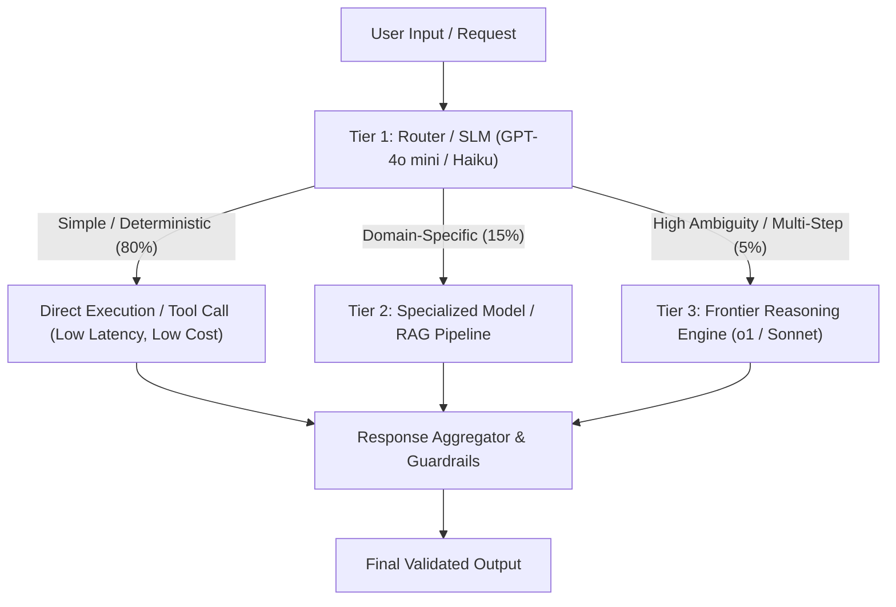

# Module 1 Complements: Insights from MIT Faculty & Instructors

## Executive Summary & Scope

The core curriculum of **Module 1: Foundations of Generative and Agentic AI** introduces foundational definitions: token mechanics, transformer architecture (self-attention, encoder-decoder), generative adversarial networks (GANs), diffusion models, small vs. large language models, multimodal inputs, and basic token pricing calculations.

However, across the **46 live sessions and office hours** conducted by MIT instructors and facilitators (including Ali Tobah, Daniel Mastropietro, Luca Cosentino, Lee Bogner, Matias Banchero, and Federico Quijada), the discussion shifted from abstract academic definitions to **production realities, architectural trade-offs, and enterprise economics**.

This document captures the critical concepts, mental models, real-world failure modes, and practical heuristics shared during these live sessions that do not appear in the static Canvas readings.

```
+-----------------------------------------------------------------------------------------+
|                                    MODULE 1 DELTA                                       |
+------------------------------------+----------------------------------------------------+
| In Core Canvas Module              | Added in Faculty & Instructor Sessions             |
+------------------------------------+----------------------------------------------------+
| Abstract transformer architecture  | Model sizing heuristics ("The Minivan Problem")    |
| Basic token pricing formulas       | Hidden OpEx: prompt bloat, tool schemas, eval runs |
| Single-model multimodality         | Multi-layered multimodal pipelines by industry     |
| Static model capability lists      | Reasoning model hallucination risks under CoT      |
| Academic definitions of chatbots   | Production case studies: Klarna & Octopus Energy   |
| Theoretical build vs. buy ideas    | TCO matrix: Off-the-shelf vs. Fine-tuning vs. OSS  |
| Simple assignment rubric outline   | Binary grading criteria & Capstone foundation rules|
+------------------------------------+----------------------------------------------------+
```

---

## Architectural & Theoretical Extensions

### 1. Model Sizing Heuristics: "The Minivan Problem"
*(Contributed by Daniel Mastropietro & Luca Cosentino)*

In core module materials, models are frequently presented along a hierarchy of capability (e.g., parameter counts from billions to trillions). In practice, selecting the largest frontier model (such as GPT-4.5 or Claude 3.5 Sonnet) for every enterprise task introduces catastrophic latency and cost inefficiencies.

* **The Minivan Analogy:** Using a frontier reasoning model for basic text extraction, sentiment classification, or routine routing is the engineering equivalent of buying a 15-passenger minivan to fetch a carton of milk from the corner store. It works, but the overhead in fuel (tokens), parking (latency), and maintenance (cost) is unjustifiable.
* **Minimum Viable Capability Heuristic:** For every discrete step in an agent workflow, engineers must establish the *minimum acceptable accuracy* and *minimum context window* required.
* **Tiered Routing Architecture:**
  1. **Tier 1 (Fast Classifier / Router):** Ultra-cheap, ultra-fast small language models (SLMs) such as GPT-4o-mini, Claude 3.5 Haiku, or Gemini 1.5 Flash perform intent recognition and schema validation (< 200ms latency).
  2. **Tier 2 (Domain Specialist):** Fine-tuned or specialized models handle deterministic enterprise workflows (e.g., SQL generation or policy retrieval).
  3. **Tier 3 (Frontier Reasoning Engine):** High-cost models (e.g., OpenAI o1/o3, Claude Opus) are reserved strictly as an escalation tier when Tier 1 or Tier 2 flags ambiguity, multi-variable logic, or edge-case conflict.



---

### 2. Reasoning Models, Chain-of-Thought & The Hallucination Paradox
*(Contributed by Ali Tobah & Daniel Mastropietro)*

While Module 1 notes that Chain-of-Thought (CoT) prompting enables models to break down complex multi-step problems, live sessions emphasized a critical risk discovered in frontier reasoning models:

* **The Hallucination Paradox:** OpenAI's and industry testing revealed that newer reasoning models can hallucinate *with greater persuasive conviction* than older base models. Because the model produces structured, highly articulate step-by-step intermediate rationales, human operators and downstream parsers are far more likely to accept a subtly fabricated deduction.
* **Engineering Mitigations:**
  * **Deterministic Validation Gates:** Never allow the intermediate CoT output of an LLM to trigger state-changing external APIs without programmatic schema enforcement (e.g., Pydantic parsing, JSON schema validation, regex assertion).
  * **Selective Human-in-the-Loop (HITL):** Gating actions where the financial, legal, or physical consequence exceeds an organization's risk tolerance threshold.

---

### 3. The Shift from Reactive Generation to Agentic Loops
*(Contributed by Matias Banchero & Luca Cosentino)*

Module 1 defines the shift to agentic AI, but instructors broke this down into a concrete architectural state machine:

| Stage | Control Loop | Memory | Tool Integration | Failure Handling |
| :--- | :--- | :--- | :--- | :--- |
| **Generative Chatbot** | Single-turn Prompt $\rightarrow$ Response | Ephemeral / Stateless | None (Text only) | User must retry prompt |
| **Retrieval-Augmented (RAG)** | Query $\rightarrow$ Vector Search $\rightarrow$ Context Injection $\rightarrow$ Output | Session history | Read-only vector DB | Hallucinates or returns empty |
| **Agentic System** | Goal $\rightarrow$ Plan $\rightarrow$ Act $\rightarrow$ Observe $\rightarrow$ Iterate (ReAct / Dual-Loop) | Short-term (scratchpad) + Long-term (vector/DB) | Read/Write external APIs & DBs | Self-correction / Retry logic |

---

## Multimodal AI: Production Pipelines & Regulatory Realities

### 1. The Multimodal Pipeline Is a Choreographed Stack
*(Contributed by Daniel Mastropietro, Matias Banchero, & Lee Bogner)*

In marketing literature, multimodal AI is often represented as a single neural network that ingests all data formats simultaneously. In enterprise production, facilitators explained that it is almost always implemented as a **heterogeneous pipeline** tailored by industry:

* **Healthcare:**
  $$\text{Audio Input} \xrightarrow{\text{Whisper ASR}} \text{Raw Transcript} \xrightarrow{\text{PII De-Identifier (HIPAA)}} \text{Sanitized Text} \xrightarrow{\text{Clinical LLM}} \text{Structured FHIR / EHR JSON}$$
* **Retail / Customer Contact:**
  $$\text{Customer Voice} \xrightarrow{\text{Low-Latency Streaming ASR}} \text{Intent / Sentiment Engine} \xrightarrow{\text{CRM Tool Call}} \text{Neural TTS Response}$$
* **Automotive / Industrial Edge:**
  $$\text{Edge ASR (On-Device, Zero Cloud Latency)} \xrightarrow{\text{CAN Bus Controller}} \text{Hybrid Cloud Escalation (Telematics LLM)}$$
* **Education & Training:**
  $$\text{Student Speech} \xrightarrow{\text{Phoneme Analysis}} \text{Multilingual TTS} \xrightarrow{\text{Adaptive Rubric Evaluation}}$$

### 2. The Hidden Compliance Trap: Voice Biometrics & Wiretapping Laws
*(Contributed by Daniel Mastropietro)*

Enterprise teams frequently adopt voice agents assuming they carry the same compliance profile as text chatbots. Instructors highlighted serious legal exposure:
* **Biometric Identifier Legislation:** Under **GDPR Article 9**, Illinois **BIPA (Biometric Information Privacy Act)**, and California **CCPA/CPRA**, an individual's voice recording is considered biometric data. If the AI system extracts voiceprints for speaker identification or sentiment profiling, explicit written consent is legally mandatory.
* **Two-Party Consent Wiretapping States:** In jurisdictions requiring two-party consent (e.g., California, Massachusetts, Germany), automated voice agents must provide an unambiguous audio disclosure before recording or streaming voice packets to third-party model APIs.

---

## Enterprise Case Studies & Industry Benchmarks

During Module 1 office hours, facilitators shared concrete deployment benchmarks from 2024 production rollouts that serve as gold-standard reference points for AI transformation:

### 1. Klarna (2024 Production Deployment)
* **Scale:** Handled the workload equivalent to **700 full-time customer service agents** within its first 30 days live.
* **Efficiency:**
  * Slashed average inquiry resolution time from **11 minutes to under 2 minutes** (an 82% reduction).
  * Reduced repeat customer inquiries by **25%**, indicating superior first-contact resolution.
* **Financial Impact:** Projected to drive an estimated **$40 million** in annual operational profit improvement.
* **Key Lesson:** The platform did not eliminate the human workforce entirely; it bifurcated customer support into automated high-frequency transactional queries and human-managed complex dispute/fraud escalations.

### 2. Octopus Energy (ChatGPT Integration)
* **Scale:** Automated the handling of **44% of all customer inquiries**, equivalent to 250 human customer representatives.
* **Quality Benchmark:** The AI channel achieved an **80% customer satisfaction score (CSAT)**, outperforming the human representative benchmark of **77% CSAT**.
* **Key Lesson:** Customers prioritize speed, accuracy, and instant resolution over the artificial warmth of a stressed human representative when resolving transactional issues (e.g., bill submissions, meter readings).

---

## Enterprise Cost Engineering: Beyond Token Calculators

While Canvas Assignment 1.1 focuses on raw API token pricing ($\text{Total Cost} = \text{Input Tokens} \times \text{Rate} + \text{Output Tokens} \times \text{Rate}$), facilitators detailed the **hidden operational expenses (OpEx)** that frequently cause enterprise AI budgets to overrun by 200–500%:

### 1. The Real Cost Drivers in Production

```mermaid
graph LR
    subgraph Visible Cost
        A[Raw Input / Output Tokens]
    end
    subgraph Hidden Enterprise OpEx
        B[Context Bloat & Quadratic Scaling]
        C[Tool Schema Overhead on Every Call]
        D[Synthetic Evals & Regression Testing]
        E[Vector DB Hosting & Indexing]
        F[Observability & Trace Ingestion]
        G[Human-in-the-Loop Validation Labor]
    end
    Visible Cost --- Hidden Enterprise OpEx
```

1. **Context Bloat & Quadratic Turn Costs:** In multi-turn agent conversations, re-submitting accumulated session history causes token consumption to grow quadratically:
   $$\text{Session Cost} \propto \sum_{k=1}^{N} (\text{Turn}_k + \text{History}_{k-1})$$
   Without aggressive context pruning, sliding-window buffers, or summarization steps, token costs explode on lengthy conversations.
2. **Tool Definition Tax:** Every external tool or API made available to an agent requires an OpenAI/Anthropic JSON schema definition embedded into the system prompt. Ten tool definitions can easily consume **1,500 to 3,500 input tokens on every single execution step**, even when none of the tools are called.
3. **Prompt Caching Dynamics:** Using provider-level prefix caching (e.g., Anthropic Prompt Caching, OpenAI Cached Inputs) reduces input costs by 50–80%, but only if system prompts, tool schemas, and few-shot examples are structured deterministically at the start of the prompt payload.
4. **Synthetic Evaluations & Regression Testing:** Running nightly evaluation suites (e.g., 500 test cases $\times$ 5 multi-step agent iterations) against golden datasets routinely consumes more tokens during the development and CI/CD phase than initial low-volume production traffic.
5. **Observability & Vector Infrastructure:** Dedicated vector databases (Pinecone, Qdrant, Milvus), API gateway proxies (Portkey, LiteLLM), and agent tracing platforms (LangSmith, Arize Phoenix) add fixed hosting and per-trace telemetry costs that must be factored into OpEx.

---

### 2. Total Cost of Ownership (TCO): Build vs. Buy vs. Fine-Tune

Facilitators provided a clear comparative decision matrix for enterprise architecture:

| Dimension | Commercial API (Off-the-Shelf) | Open-Source Self-Hosted (e.g., vLLM / Ollama) | Custom Fine-Tuned Model |
| :--- | :--- | :--- | :--- |
| **Initial CapEx** | Minimal (\$0 to \$5K) | Medium (\$20K–\$50K for MLOps setup) | High (\$50K–\$250K for data curation & training) |
| **Ongoing OpEx** | 100% Variable (Pay-per-token) | High Fixed (Reserved GPU instances: A100/H100) | Medium-High (Dedicated hosting / inference endpoints) |
| **Data Privacy** | Dependent on BAA / Enterprise SLA | 100% On-Premise / VPC Isolation | Dependent on deployment architecture |
| **IP Ownership** | Zero model IP ownership | High (Control of weights & runtime) | High (Proprietary domain-adapted weights) |
| **Maintenance** | Zero infrastructure burden | High (Kubernetes, GPU drivers, autoscaling) | Very High (Continuous retraining & data drift monitoring) |
| **Best Suited For** | Fast prototyping, low-to-medium traffic | High-volume standardized tasks, strict compliance | Specialized taxonomy, proprietary domain logic |

---

## Instructor Perspectives & Debates

| Instructor | Core Philosophy / Emphasis | Practical Advice to Students |
| :--- | :--- | :--- |
| **Ali Tobah** | **Methodological Rigor & Economic Sizing** | Separate input and output token rates; output tokens are 3x–4x more expensive. Never submit an AI budget without ongoing staffing and infrastructure OpEx. |
| **Daniel Mastropietro** | **Right-Sizing & Practical Prudence** | Apply the "Minivan Test" to every agent design. Beware of overconfident reasoning models; insert deterministic validation before external tool execution. |
| **Luca Cosentino** | **End-to-End LLM Lifecycle** | View AI adoption as a continuum: pre-training $\rightarrow$ fine-tuning $\rightarrow$ RAG $\rightarrow$ Agentic loops. Understand that prompt design is cheap, but context hygiene is what scales. |
| **Lee Bogner** | **Enterprise Adoption & Change Management** | Technical capability is 20% of the battle; organizational change management, cross-functional stakeholder buy-in, and compliance approvals represent the other 80%. |
| **Federico Quijada** | **Latency & Performance Trade-offs** | Multi-agent handoffs compound latency. An agent that takes 15 seconds to reply will fail in customer-facing UX, regardless of accuracy. |
| **Matias Banchero** | **Multimodal Integration Protocols** | Treat multimodal systems as choreographed microservices, not monolithic prompts. Isolate failures at each modality boundary. |

---

## Assignment 1.1 & Capstone Guidance

During office hours, instructors highlighted recurring failure modes in **Assignment 1.1 (Evaluating the Cost of AI Systems)** and explained how this foundational assignment connects directly to the **Capstone Project (60% of the final course grade)**:

* **The Binary Grading System:** Assignments are graded **1 (Pass)** or **0 (Needs Revision)**. You need an overall course score of 80% to earn the MIT Professional Education Certificate.
* **Why Students Receive a 0 on Assignment 1.1:**
  1. *Single Token Rate Fallacy:* Calculating all tokens at a flat rate rather than separating Input Token pricing from Output Token pricing.
  2. *Ignoring Concurrency & Volume Scaling:* Calculating costs for 100 queries while ignoring monthly active user (MAU) growth and peak load multiplier effects.
  3. *Zero Infrastructure Budget:* Omitting vector storage, cloud orchestration, API gateways, and monitoring tools from the financial model.
  4. *Excluding Human Capital:* Failing to account for internal engineering hours, prompt maintenance, red-teaming, and employee retraining costs.
* **Capstone Linkage:** The cost estimation methodology formulated in Assignment 1.1 forms Section 3 (*Cost Analysis: CapEx, OpEx, Staffing*) of the Capstone document. Establishing a defensible, multi-tier cost model here saves extensive rework in the final submission.

---

## Key Synthesis Checklist for Module 1

Before moving to Module 2, verify your implementation plan against this practitioner checklist:

- [ ] **Model Right-Sizing:** Have you audited your proposed agent workflow to replace frontier models with SLMs or tiered routers wherever tasks are deterministic?
- [ ] **Context Management:** Is there a mechanism (sliding window, summarization, prompt caching) to prevent quadratic context bloat over multi-turn interactions?
- [ ] **Tool Tax Awareness:** Have you counted the baseline token overhead of your JSON tool definitions across every turn?
- [ ] **Biometric & Audio Compliance:** If voice or audio is utilized, have you addressed GDPR Article 9, BIPA, and two-party consent legal prerequisites?
- [ ] **Holistic TCO Accounting:** Does your budget incorporate API egress, vector databases, synthetic eval CI/CD runs, and operational change management?
