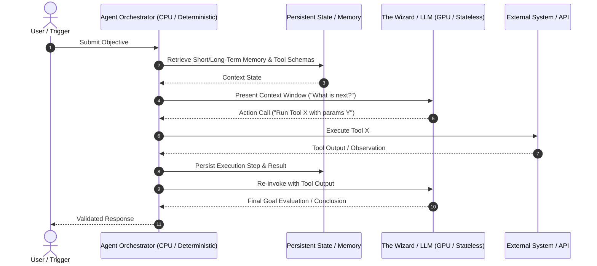

# Module 2 Complements: Insights from MIT Faculty & Instructors

## Executive Summary & Scope

**Module 2: The Rise of Agentic AI and Emerging AI Platforms** examines the conceptual transition from passive prompt-response chatbots to goal-driven autonomous agents. In the core Canvas modules, the focus is on Andrej Karpathy's concept of "Vibe Coding," visual automation platforms (Zapier Central, n8n, Flowise), and high-level platform surveys.

However, in the **Welcome Webinar with Faculty Directors Dr. Abel Sanchez and Dr. John Williams**, alongside **23 instructor office hours** (led by Luca Cosentino, Ali Tobah, Amado Lopez, Lee Bogner, and Arnold Schiemann), the discussion elevated into **foundational system architecture, the economics of commodity intelligence, and production-grade software engineering**.

```
+-----------------------------------------------------------------------------------------+
|                                    MODULE 2 DELTA                                       |
+------------------------------------+----------------------------------------------------+
| In Core Canvas Module              | Added in Faculty & Instructor Sessions             |
+------------------------------------+----------------------------------------------------+
| "Vibe Coding" as rapid prototyping | "Harness Engineering" & the discipline to "Devibe" |
| High-level platform overviews      | Deep critique: LangChain vs CrewAI vs AutoGen vs OS|
| Abstract autonomous definitions    | The "Agent-and-Wizard" architectural paradigm      |
| Workflow vs prompt definitions     | "Reasoning is not a workflow" design law           |
| Low-code platform showcases        | Three structural platform selection questions      |
| Conceptual cognitive automation    | Macroeconomics of "Commodity Intelligence"         |
| Assignment 2.1 platform survey     | Grading rubrics & state-machine design heuristics  |
+------------------------------------+----------------------------------------------------+
```

---

## Architectural Paradigms: The Faculty Masterclass

### 1. The "Agent-and-Wizard" Architecture
*(Contributed by Dr. John R. Williams & Dr. Abel Sanchez — Welcome Webinar)*

A fundamental conceptual error among enterprise teams is assuming the Large Language Model *is* the agent. Dr. John Williams presented the foundational decoupling required for robust agentic systems:

* **The Wizard (The LLM):**
  * Lives in a **GPU-accelerated environment**.
  * It is entirely **stateless and amnesic**: it processes the provided context window, computes the next token probabilities, emits an output, and immediately forgets everything.
  * It cannot execute code, access external databases, or remember past interactions on its own.
* **The Agent / Robot (The Deterministic Orchestrator):**
  * Lives in a **traditional CPU-based compute environment** (Node.js, Python, microservices).
  * Manages state, persistent storage, business logic, session memory, and tool integration.
* **The Interplay Loop:**
  1. The Agent packages memory, tools, and user instructions into a curated context window and presents it to the Wizard.
  2. The Wizard analyzes the context and returns a structured call: *"Please execute Tool X with Parameters Y."*
  3. The Agent executes Tool X locally in the deterministic environment, captures the result, appends it to the context, and re-invokes the Wizard.



---

### 2. "Reasoning Is Not a Workflow"
*(Contributed by Amado Lopez & Arnold Schiemann)*

A major pitfall in enterprise agent development is confusing probabilistic reasoning with deterministic business process execution:

> **Core Architectural Law:** *"An LLM reasoning about a problem is inherently non-deterministic. A business process must be deterministic. Therefore, reasoning steps must always be bounded inside a deterministic state machine."*

* **The Danger of Unbounded Agency:** Granting an LLM open-ended autonomy to decide *how* a process moves from step A to step Z leads to hallucinations, infinite loops, and unrepeatable business transactions.
* **The State Machine Solution:** The overall sequence (e.g., Lead Ingestion $\rightarrow$ KYC Verification $\rightarrow$ Credit Risk Scoring $\rightarrow$ Account Creation) must be enforced by code (e.g., LangGraph, Temporal, AWS Step Functions). The LLM is invoked only *within* discrete state transitions to resolve unstructured data or reason over ambiguous edge cases.

---

### 3. The Macroeconomics of "Commodity Intelligence"
*(Contributed by Dr. Abel Sanchez — Welcome Webinar)*

Dr. Sanchez framed the emergence of agentic AI within the broader history of technological revolutions:

* **The Industrial Revolution Parallel:** The steam engine and electrical grid commoditized *physical muscle power*, transforming artisanal manufacturing into scalable global industry.
* **The Cognitive Revolution:** Agentic AI commoditizes *cognitive intelligence*. Capabilities that once required an elite PhD or specialized professional (e.g., complex multi-system research, statistical modeling, cross-language contract synthesis) are becoming on-demand utilities accessible via API for fractions of a cent.
* **The "Workforce Apocalypse" Fallacy:** Addressing widespread fears of labor displacement, Dr. Sanchez highlighted that macroeconomic data shows overall job growth, not contraction. Technology automates *tasks*, not entire jobs. Liberating professionals from repetitive analytical toil shifts human labor toward strategic orchestration, judgment, and high-empathy leadership.

---

## "Vibe Coding" vs. "Harness Engineering"

While Module 2 celebrates Andrej Karpathy's concept of **Vibe Coding** (using AI to code via intuitive, natural-language conversation without manually typing syntax), MIT facilitators issued a severe technical warning for enterprise environments:

### 1. The "Devibing" Imperative
*(Contributed by Ali Tobah)*

* **The Prototype Trap:** Vibe coding creates an illusion of velocity. A non-technical manager or junior engineer can generate a functional web app or integration script in 30 minutes.
* **The Production Hangover:** These prototypes lack input sanitization, error handling, database indexing, regression tests, and architectural coherence.
* **The "Devibing" Process:** The necessary, disciplined phase where software engineers take vibe-coded prototypes and systematically:
  1. Eliminate redundant token calls and circular dependencies.
  2. Enforce strict type definitions and schema assertions.
  3. Decouple hardcoded secrets and environment variables.
  4. Implement database migration scripts to resolve schema fragmentation.

### 2. "Harness Engineering"
*(Referenced by Ali Tobah via Cassie Kozyrkov)*

When building systems where code is authored by autonomous models, software engineering shifts from **writing code** to **building test harnesses**:

```
+-----------------------------------------------------------------------+
|                         HARNESS ENGINEERING                           |
+-----------------------------------------------------------------------+
|  [ Invariant Checks ] --> Asserts that core business rules never break|
|  [ Sandboxed Runtime] --> Executes model-generated code in isolation  |
|  [ Synthetic Bench  ] --> Runs 1,000 edge cases on every generation   |
|  [ Regression Gates ] --> Automatically rejects drift in output schema|
+-----------------------------------------------------------------------+
```

Organizations that succeed with agentic coding do not read every line of generated code; instead, they build automated, impervious test harnesses that reject any generated output violating predefined invariants.

---

## The Platform Selection Decision Framework

In office hours, Luca Cosentino and Amado Lopez structured the fragmented landscape of agentic platforms into a clear architectural decision matrix based on three governing questions:

### The Three Governing Questions
1. **The Coordination Problem:** How does the platform coordinate multi-agent workflows (hierarchical vs. sequential vs. cyclic graphs)?
2. **The Data Sovereignty Problem:** Where does execution and inference occur (public cloud API vs. private VPC vs. local edge runtime)?
3. **The Control Problem:** Who controls the weights, runtime abstractions, and framework lifecycle (open-source vs. proprietary closed-ecosystem)?

### Platform Comparative Matrix

| Platform | Architectural Pattern | Primary Strengths | Critical Production Limitations | Best Fit Scenario |
| :--- | :--- | :--- | :--- | :--- |
| **LangChain / LangGraph** | Cyclic State Graph (State Machine) | Extreme control, cyclic loops, built-in checkpointing & human-in-the-loop pause/resume. | Steep learning curve; frequent breaking changes across minor versions. | Complex, enterprise-grade stateful applications requiring custom logic. |
| **CrewAI** | Role-Based Hierarchical Collaboration | Intuitive mental model (`Role`, `Goal`, `Backstory`); excellent multi-agent delegation. | Pure Python (no visual UI); difficult for non-technical domain stakeholders. | Collaborative team simulation (e.g., automated market research or multi-tier drafting). |
| **Microsoft AutoGen** | Event-Driven Conversational Multi-Agent | Native sandboxed code execution; dynamic conversational topologies. | Difficult to constrain non-deterministic banter; debugging asynchronous state is complex. | Code generation, data science exploration, and technical research simulations. |
| **Ollama / vLLM** | Local / Self-Hosted Inference Runtime | 100% data confidentiality; zero cloud API token costs; predictable local latency. | Requires dedicated GPU hardware; model capability lags frontier cloud models. | Regulated data (HIPAA, banking, defense) requiring strict data sovereignty. |
| **n8n / Flowise / Make** | Visual Node-Based Workflow Automation | Low-code accessibility; massive pre-built API connectors; rapid business enablement. | Brittle for complex, non-deterministic agent loops; difficult version control in Git. | Rapid internal tooling, deterministic webhook orchestration, and MVP prototypes. |

---

## Instructor Perspectives & Office Hour Debates

* **Luca Cosentino:** *"The agentic landscape is currently the 'Wild West.' Standards have not solidified, and today's dominant frameworks may be obsolete in 18 months. Organizations should not marry a single framework; they must develop 'evaluation fluency' so they can migrate workflows as the ecosystem matures."*
* **Amado Lopez:** *"Do not ask an agent to do everything. Build specialized, single-purpose agents with constrained context windows, and coordinate them through deterministic event buses."*
* **Lee Bogner:** *"Low-code platforms like Zapier Central or n8n empower business units, but without enterprise IT oversight, they create massive security holes and duplicate SaaS spend. Platform adoption requires central governance."*
* **Arnold Schiemann:** *"Traditional software executes predefined instructions. Generative AI generates text. Agentic AI pursues an objective. That distinction must be reflected in your architecture: if you don't give an agent an explicit evaluation metric, it cannot know when its goal is achieved."*

---

## Assignment 2.1 & Capstone Playbook

### Navigating Assignment 2.1
Assignment 2.1 asks students to select an agentic platform and evaluate its implementation for an organizational workflow. Facilitators provided clear guidance on passing criteria:

1. **Avoid the "Feature List" Trap:** Do not simply regurgitate marketing bullets from the platform's homepage. The evaluation must analyze architectural trade-offs (hosting, latency, security, talent required).
2. **Explicitly Address Data Sovereignty:** You must define where client data travels. If choosing a cloud-hosted framework, detail how encryption, data retention, and enterprise SLAs are handled.
3. **State Management & Failure Modes:** Explain what happens when a tool execution fails or an API times out. Does the platform support checkpointing and graceful recovery?

### Direct Connection to the Capstone Project
Section 2 of your Capstone Project requires a justified **Technology Choice**. The comparative evaluation conducted in Module 2 directly populates this requirement:
* If building with Salesforce Agentforce (as in Remi's Capstone use case), contrast it with open-source frameworks (CrewAI, LangGraph).
* Justify why an enterprise CRM native agent (Agentforce) was selected over a standalone custom framework (e.g., immediate access to Salesforce Data Cloud, built-in Einstein Trust Layer, pre-existing OAuth permissions, zero custom API connector maintenance).

---

## Key Synthesis Checklist for Module 2

- [ ] **Decouple Agent & Wizard:** Is your architecture clearly separated into a deterministic orchestrator (CPU) and a stateless reasoning model (GPU)?
- [ ] **State Machine Invariants:** Are your business workflows governed by deterministic state graphs rather than unconstrained model chat loops?
- [ ] **Harness Engineering:** Have you defined automated assertion tests and schema validators to guard against hallucinated tool calls?
- [ ] **Platform Governance:** Have you evaluated the trade-offs between low-code business accessibility and code-based observability?
- [ ] **Data Sovereignty:** Does your platform architecture comply with organizational data privacy and sovereign hosting mandates?
