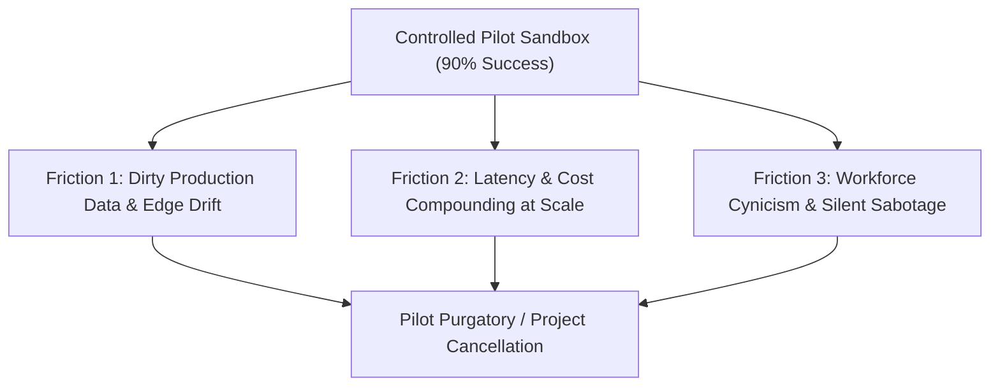

# Module 6 Complements: Insights from MIT Faculty & Instructors

## Executive Summary & Scope

**Module 6: The Last Mile—From Pilot to Practice** addresses the phenomenon known as "Pilot Purgatory": why do dozens of successful enterprise AI proofs-of-concept (POCs) fail to transition into sustained, scalable production? In the core Canvas module, the readings introduce voice agents, telephony systems, and broad organizational change management concepts.

However, across the **23 live sessions and office hours** conducted by Ali Tobah, Saskia Listle, Amado Lopez, Simon Barna, and guest speaker Sheila Eckert (Founder of Frankee.ai and author of *Agile Meets AI*), the curriculum focused on **operationalizing the last mile**. Facilitators detailed **structured logging telemetry, four-dimensional KPI design, the law of process decomposition, and the discipline of progressive autonomy (Crawl, Walk, Run)**.

```
+-----------------------------------------------------------------------------------------+
|                                    MODULE 6 DELTA                                       |
+------------------------------------+----------------------------------------------------+
| In Core Canvas Module              | Added in Faculty & Instructor Sessions             |
+------------------------------------+----------------------------------------------------+
| Conceptual "Pilot to Practice" gap | Root causes of pilot stalls: adoption, not tech   |
| General change management theories | Saskia Listle's Law of Process Decomposition       |
| High-level voice agent overviews   | Real-time telephony latency & duplex audio traps   |
| Basic business performance metrics | The 4-Dimensional Agent KPI Framework              |
| Abstract scaling discussions       | Crawl-Walk-Run operational phasing model           |
| Generic production advice          | Transitioning proven LLM loops into code scripts   |
| Standard assignment guidelines     | Structured JSON telemetry design for agent evals   |
+------------------------------------+----------------------------------------------------+
```

---

## Overcoming the Last-Mile Stall: The Engineering Truth

### 1. Why AI Pilots Stall at Scale
*(Contributed by Ali Tobah & Simon Barna)*

In enterprise pilots, an AI team typically demonstrates a 90% success rate inside a controlled sandbox with curated data and enthusiastic volunteer users. When moving to production, deployments stall due to three unaddressed friction points:



1. **Uncurated Input Entropy:** Sandboxes use clean, structured test cases. Production environments feed the agent messy, ambiguous, and hostile real-world data, causing error rates to spike.
2. **Workforce Cynicism and Silent Sabotage:** If frontline employees perceive an agent as a precursor to layoffs or a threat to their professional standing, they will not adopt it. They will actively bypass the agent or deliberately highlight edge-case errors to prove the system cannot be trusted.
3. **The Governance Vacuum:** POCs rarely include audit logging, role-based access control, or formal liability protocols. The moment compliance and legal teams review the pilot, they issue an immediate halt.

---

### 2. Saskia Listle's Law of Process Decomposition
*(Contributed by Saskia Listle)*

A foundational insight delivered in Module 6 challenges how organizations conceptualize workflow automation:

> **The Law of Decomposition:** *"You cannot automate a process. You can only automate a step. The real engineering work is in the decomposition."*

* **The Fallacy:** Attempting to automate an entire business process (e.g., *"Automate our client onboarding process"*) as a single monolithic agent task. This creates an unmanageable context window, introduces dozens of potential failure modes, and makes debugging impossible.
* **The Solution (Granular Step Decomposition):**
  1. Map the complete process into discrete, sequential micro-steps.
  2. Score each micro-step on two axes: **Task Predictability** (deterministic vs. probabilistic) and **Risk Severity** (reversible vs. irreversible).
  3. Automate only the high-predictability, low-risk micro-steps first, maintaining deterministic software gates between them.

---

### 3. Transitioning Proven Agentic Loops into Deterministic Scripts
*(Contributed by Saskia Listle & Ali Tobah)*

A critical cost-optimization and compliance strategy discussed in live sessions is knowing when to **stop using an LLM**:

* **The Problem:** Non-deterministic LLM calls are expensive, slow (500ms–3000ms), and carry non-zero hallucination probabilities.
* **The Transition Pattern:**
  * In the early pilot phase, an agentic LLM explores unstructured data, maps edge cases, and determines optimal routing paths.
  * Once the workflow patterns stabilize and 95% of transactions follow predictable logic, **strip out the LLM for that step and rewrite it as a deterministic Python/Bash script or API microservice**.
  * **Result:** Collapses operational token costs by 90%, reduces execution latency from seconds to milliseconds, and ensures 100% audit reproducibility in regulated sectors.

---

## The 4-Dimensional Agent KPI Framework

*(Contributed by Ali Tobah, Asrar Alam, & Amado Lopez)*

While Canvas materials discuss standard business KPIs (e.g., cost savings, ROI), facilitators emphasized that **AI agents require an entirely distinct four-dimensional measurement framework**:

```
+-----------------------------------------------------------------------------------------+
|                         4-DIMENSIONAL AGENT KPI FRAMEWORK                               |
+-----------------------------------+-----------------------------------------------------+
| 1. EFFECTIVENESS (Quality)        | 2. EFFICIENCY (Operational Cost & Speed)            |
| - Task Completion Rate (% Goal)   | - Average Cost per Run ($/execution)               |
| - First-Contact Resolution Rate   | - Token Consumption per Task Trend                  |
| - Factual Accuracy vs. Gold Standard | - Latency per Step / Total Response Time (ms)     |
+-----------------------------------+-----------------------------------------------------+
| 3. LEARNING & ADAPTATION          | 4. HUMAN FACTORS (Trust & Adoption)                 |
| - Prompt Rework Rate (% retries)  | - Human Handoff / Escalation Rate                   |
| - Hallucination / Schema Error Rate | - Operator Override Rate (% human edits)          |
| - Autonomous Self-Correction Rate | - Employee Trust & Satisfaction Score (CSAT/eNPS)   |
+-----------------------------------+-----------------------------------------------------+
```

### Structured Telemetry: Logs Are the Foundation of KPIs
*(Contributed by Amado Lopez)*
Facilitators noted that KPIs cannot be calculated retrospectively from high-level estimates; they must be computed from **structured JSON telemetry emitted at every step**:

```json
{
  "session_id": "sess-84920",
  "step_index": 3,
  "agent_id": "onboarding-agent",
  "model_used": "claude-3-5-haiku",
  "tokens": {"input": 420, "output": 85, "cached": 310},
  "latency_ms": 480,
  "tool_called": "verify_tax_id",
  "tool_status": "success",
  "human_override": false,
  "validation_error": null
}
```

---

## Phased Autonomy: The Crawl-Walk-Run Model

*(Contributed by Ali Tobah, Sheila Eckert, & Luca Cosentino)*

To prevent catastrophic organizational failure, autonomy must be deployed incrementally:

```mermaid
flowchart LR
    subgraph Crawl: Human in the Loop (100% Oversight)
        C1[Agent Proposes / Drafts] --> C2[Human Reviews & Edits] --> C3[Human Executes Action]
    end
    subgraph Walk: Human on the Loop (Exception Gated)
        W1[Agent Executes Low-Risk Action] --> W2[Audit Telemetry Emitted]
        W1 -->|High Risk / Ambiguity| W3[Human Escalation Gate]
    end
    subgraph Run: Human out of the Loop (Supervisory Auditing)
        R1[Agent Closed-Loop Execution] --> R2[Continuous Anomaly Scoring]
        R2 -->|Out-of-Bounds Variance| R3[Automated Circuit Breaker]
    end
    Crawl --> Walk --> Run
```

### 1. Crawl (AI-Assisted, Human-Executed)
* **Mechanics:** The agent operates strictly as a copilot. It ingests data, extracts facts, and prepares drafted responses or recommendations.
* **Human Role:** A human operator reviews, edits, and manually clicks "Submit." 100% human-in-the-loop (HITL).
* **Goal:** Build operator trust, gather baseline telemetry, and curate gold-standard datasets.

### 2. Walk (AI-Executed, Human-Monitored)
* **Mechanics:** The agent is granted direct write access to execute low-risk, deterministic actions (e.g., updating business hours, logging notes, sending standard confirmation emails).
* **Human Role:** Humans monitor dashboards, inspect sample batches, and step in only when the agent flags confidence scores below a defined threshold (e.g., < 85%).

### 3. Run (Autonomous Operations with Circuit Breakers)
* **Mechanics:** The agent handles end-to-end, multi-step workflows autonomously.
* **Human Role:** Humans conduct periodic spot-audits, review monthly KPI drift, and respond to automated anomaly alerts triggered by circuit breakers.

---

## Production Case Study: Frankee.ai (Building an Agile Teammate)

*(Guest Speaker Session: Sheila Eckert, Founder of Frankee.ai)*

Sheila Eckert, an alumna of the MIT program and veteran software engineering leader, presented real-world architectural lessons from deploying **Frankee**, an autonomous agile team assistant:

1. **Role-Specific Focus Inside the Lifecycle:** Frankee does not try to manage the entire Product Development Lifecycle (PDLC). It is embedded strictly inside the **Define** and **Learn** stages—generating INVEST-compliant user stories, planning sprints, and detecting action items during retrospectives.
2. **The Fragility of Model Upgrades:** When switching an underlying LLM tier, an unannounced API change truncated output lengths, causing user story generation to break silently. **Key Lesson:** Production agents require automated integration test suites that run against new model versions before promoting them to production.
3. **The "Human in the Decision Seat" Rule:** While Frankee autonomously extracts sprint blockers from chat channels, it never reschedules a sprint or assigns tickets to engineers without an explicit confirmation click from the Scrum Master.

---

## Instructor Perspectives & Debates

* **Ali Tobah:** *"The last mile is never a technology problem. Technology is ready today. The last mile is organizational: it is the alignment of incentives, psychological safety, and clear liability boundaries."*
* **Saskia Listle:** *"If your change management plan consists of sending employees a PDF guide and holding a 30-minute webinar, your AI deployment will fail. Employees need hands-on prompt workshops where they co-design the agent's guardrails."*
* **Amado Lopez:** *"If you cannot show me your logging architecture, you do not have a deployment strategy. You cannot improve what you cannot measure, and you cannot govern what you cannot trace."*
* **Simon Barna:** *"Never scale an unmeasured agent. If you scale a flawed pilot, you are simply industrializing error generation."*

---

## Assignment 6.1 & Capstone Guidance

### Navigating Assignment 6.1
Assignment 6.1 requires designing a comprehensive KPI framework and scaling plan for an organizational AI agent:

1. **Cover All Four KPI Dimensions:** Submissions that only calculate financial ROI or time saved will receive a 0. You must include:
   * **Effectiveness:** Task success / accuracy rate.
   * **Efficiency:** Cost per transaction and latency.
   * **Learning & Adaptation:** Prompt rework and drift rate.
   * **Human Factors:** Handoff rate and user CSAT.
2. **Explicit Crawl-Walk-Run Milestones:** Define exact calendar timelines, autonomy levels, and quantitative criteria required to graduate from Crawl to Walk, and from Walk to Run.

### Capstone Project Integration
* Module 6 directly forms **Section 6 (Scaling Architecture: Crawl, Walk, Run)** and **Section 8 (Operational & Financial KPIs)** of the Capstone plan.
* For Remi's Capstone use case (**Olivia on Salesforce Agentforce**):
  * *Crawl:* Olivia suggests WhatsApp opening hour extensions to account managers; account managers review and send.
  * *Walk:* Olivia messages restaurant partners directly; if the partner replies "YES", Olivia updates Salesforce and the backend POS autonomously; if the partner asks a question or replies ambiguously, Olivia routes to a human agent.
  * *Run:* Olivia operates autonomously across Benelux and Germany; account managers review weekly conversion dashboards and anomaly logs.

---

## Key Synthesis Checklist for Module 6

- [ ] **Granular Step Decomposition:** Have you broken down your process into discrete micro-steps rather than trying to automate the entire end-to-end workflow at once?
- [ ] **Transition to Code:** Have proven, predictable LLM steps been evaluated for refactoring into deterministic Python/microservice scripts?
- [ ] **Four-Dimensional Telemetry:** Does your logging infrastructure capture Effectiveness, Efficiency, Learning, and Human Factors metrics in structured JSON?
- [ ] **Progressive Autonomy Gates:** Are explicit quantitative thresholds established to govern when the system moves from Crawl to Walk, and from Walk to Run?
- [ ] **Workforce Alignment:** Have frontline employees been integrated into the co-design of the agent to eliminate adoption resistance and sabotage?
