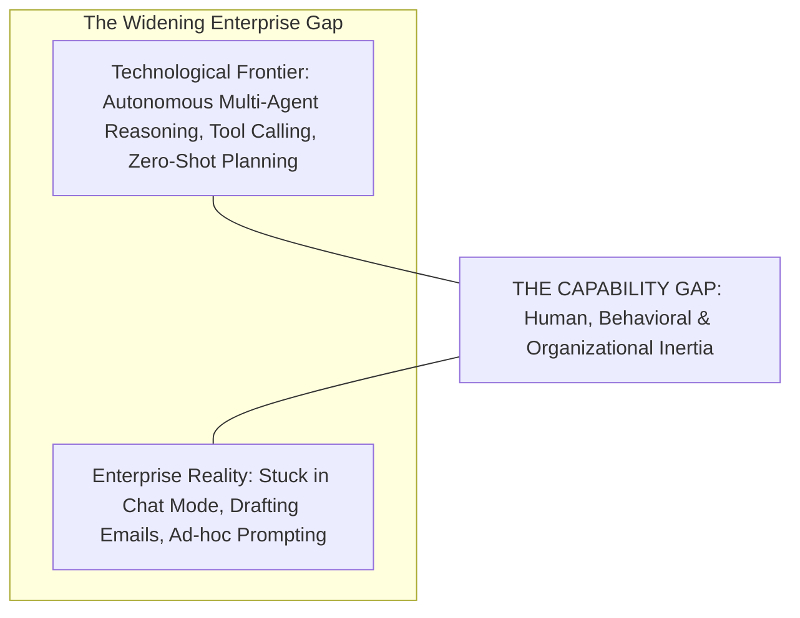
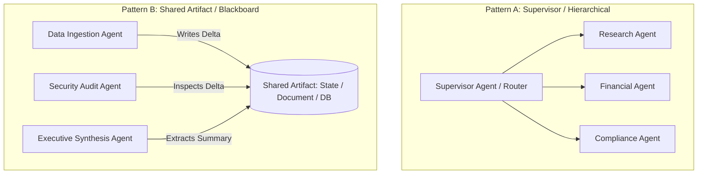

# Module 8 Complements: Insights from MIT Faculty & Instructors

## Executive Summary & Scope

**Module 8: Ethics and Capstone** represents the culmination of the MIT Professional Education program. In the Canvas portal, the content is brief: high-level philosophical reflections on AI ethics (fairness, accountability, workforce displacement) and formal submission instructions for the **Capstone Project (the final exam, worth 60% of the course grade)**.

However, the live sessions for Module 8—anchored by the **Wrap-up Webinar with Faculty Directors Dr. Abel Sanchez and Dr. John Williams**, along with **20 office hours** from Ali Tobah, Luca Cosentino, Oscar Sanchez, and Rui Basilio de Carvalho—delivered the course's most strategic synthesis. The faculty addressed **the macroeconomics of hyperscaler CapEx and power grid bottlenecks, the 'Capability Gap' stalling enterprise adoption, advanced multi-agent orchestration topologies, and the operational playbook for passing the Capstone Project**.

```
+-----------------------------------------------------------------------------------------+
|                                    MODULE 8 DELTA                                       |
+------------------------------------+----------------------------------------------------+
| In Core Canvas Module              | Added in Faculty & Instructor Sessions             |
+------------------------------------+----------------------------------------------------+
| Philosophical ethics reflections   | Operational ethics: Oscar Sanchez's Mailroom Model |
| Abstract workforce disruption fear | The "Capability Gap": why enterprises stay in chat |
| High-level Capstone brief outline  | The Capstone Masterclass: binary scoring & pitfalls|
| Brief mention of multi-agent tasks | Supervisor vs. Shared-Artifact orchestration       |
| General sustainability mentions    | Physical infrastructure: Nuclear power & GW grids  |
| Standard course wrap-up comments   | Executive leadership translation & board governance|
+------------------------------------+----------------------------------------------------+
```

---

## Macro-Dynamics: The Faculty Directors' Strategic Briefing

*(Contributed by Dr. Abel Sanchez & Dr. John R. Williams — Wrap-up Webinar)*

### 1. The Enterprise "Capability Gap"
Dr. Abel Sanchez addressed the paradox defining enterprise artificial intelligence:

> **The Capability Gap Reality:** *"We possess performant technology that was the exclusive domain of science fiction five years ago. Yet, when we examine enterprise deployments, there is a massive, widening capability gap. The tragedy is that 85% of corporate usage remains stuck at the very top: basic text editing, summarization, and conversational chat mode. Organizations are failing to build autonomous agency."*



* **The Root Cause:** The capability gap is **human, behavioral, and organizational—not technical**.
* **The Leadership Vacuum:** Board directors and executive committee members have decades of operational experience, but lack the mental models to evaluate non-deterministic, agentic software. When technical teams present complex LLM pipelines, boards default to defensive skepticism.
* **The Strategic Antidote:** AI leaders must translate agentic capabilities into traditional corporate vernacular: risk registers, OpEx compression, balance sheet efficiency, and compliance guarantees.

### 2. Hyperscaler CapEx & The Physical Limits of Compute
Dr. Sanchez and Dr. Williams provided context on the macro infrastructure powering agentic models:
* **The Hundreds-of-Billions Investment:** Major hyperscalers (Microsoft, Alphabet, Amazon, Meta) are investing upwards of $100–$150 billion annually in GPU clusters and custom silicon.
* **The Energy & Grid Bottleneck:** The primary constraint on frontier AI advancement has shifted from algorithmic breakthroughs to **electrical power generation**. Data center power demands are driving multi-gigawatt power purchase agreements, the reactivation of decommissioned nuclear reactors (e.g., Three Mile Island / Constellation Energy), and dedicated grid infrastructure.
* **The Enterprise Implication:** Cloud inference token prices will continue to deflate through architectural efficiency, but localized and sovereign hosting will face severe hardware allocation constraints.

---

## Advanced Multi-Agent Orchestration Patterns

*(Contributed by Dr. John R. Williams & Luca Cosentino)*

In the concluding webinar, Dr. John Williams detailed how multi-agent architectures must be organized once an enterprise scales beyond single-agent scripts:



### 1. The Supervisor / Hierarchical Orchestrator Pattern
* **Structure:** A central LLM acts as the orchestrator/supervisor. It inspects the overarching goal, breaks it into discrete sub-tasks, assigns each sub-task to a specialized worker agent, evaluates the returned outputs, and synthesizes the final result.
* **Context Hygiene:** The supervisor maintains a high-level summary context window, while worker agents operate within isolated, highly specialized context windows. This prevents context window pollution and eliminates prompt token bloat.

### 2. The Shared Artifact (Blackboard) Pattern
* **Structure:** Multiple agents do not message each other directly in a conversational daisy-chain. Instead, they operate asynchronously around a shared data artifact (e.g., a shared state database, a JSON workspace, or a draft document).
* **Advantage:** Decouples agents completely. If the Research Agent updates the shared database, the Compliance Agent inspects the change without requiring a direct conversational handoff. This eliminates the prompt-coupling fragility ("Chain Jam") identified in Module 5.

---

## Operationalizing Ethics: Oscar Sanchez's "Mailroom Metaphor"

*(Contributed by Oscar Sanchez & Ali Tobah)*

In the core Module 8 readings, AI ethics is often discussed as an abstract philosophical debate. Oscar Sanchez reframed ethics as a concrete corporate operational procedure:

> **The Mailroom Metaphor:** *"Treat an autonomous AI agent exactly like a corporate mailroom. A mailroom clerk does not read your private letters (privacy); they must deliver packages only to verified recipients (access control); they log every inbound and outbound parcel in a ledger (auditability); they refuse to transport hazardous or illegal cargo (guardrails); and if a package is damaged or lost, the mailroom supervisor is legally accountable (human responsibility)."*

```
+-----------------------------------------------------------------------------------------+
|                        THE OPERATIONAL ETHICS FRAMEWORK                                 |
+-----------------------------------+-----------------------------------------------------+
| Ethical Principle                 | Concrete Operational Mechanism                      |
+-----------------------------------+-----------------------------------------------------+
| 1. Fairness & Bias Prevention     | Continuous disparate impact testing on synthetic    |
|                                   | demographic datasets; zero demographic proxy inputs.|
+-----------------------------------+-----------------------------------------------------+
| 2. Transparency & Explainability  | Structured decision rationales emitted in metadata; |
|                                   | user notified they are interacting with an AI.      |
+-----------------------------------+-----------------------------------------------------+
| 3. Privacy & Purpose Limitation   | PII token masking; zero-data-retention vendor SLAs; |
|                                   | database write boundaries enforced via IAM.         |
+-----------------------------------+-----------------------------------------------------+
| 4. Human Accountability           | A designated corporate role (Director of Ops) holds |
|                                   | statutory liability for every agent decision.       |
+-----------------------------------+-----------------------------------------------------+
| 5. Proportional Intervention      | Low-confidence or high-financial-impact operations  |
|                                   | automatically route to human review queues.         |
+-----------------------------------+-----------------------------------------------------+
```

---

## The Capstone Project: The Masterclass for Passing

*(Contributed by Ali Tobah, Lee Bogner, Oscar Sanchez, & Rui Basilio de Carvalho)*

The Capstone Project accounts for **60% of the entire course grade** and determines whether a student receives the MIT Professional Education Certificate. Instructors provided explicit guidance on what distinguishes a passing submission from an immediate rejection:

### 1. The Binary Grading Reality (1 or 0)
* Graded strictly as **1 (Pass)** or **0 (Needs Revision)**.
* Length: Exactly **2 to 5 pages** in Word or PDF format.
* **Resubmission Policy:** If a student receives a 0, they are permitted to revise and resubmit before the absolute course deadline. However, on-time submissions receive grading priority.

### 2. The 8 Mandatory Capstone Sections & Common Failure Points


1. **Context & Problem Definition (Sector, Org, Department):**
   * *Fatal Error:* Selecting an overly broad use case ("Transforming Healthcare with AI"). Focus on *one specific department* and *one concrete operational bottleneck*.
2. **Technology Choice & System Integration:**
   * *Fatal Error:* Merely listing tools without justifying architectural trade-offs. Detail hosting (cloud vs. local), model tiers, and integration middleware (MCP / APIs).
3. **Cost Model (CapEx, OpEx, Staffing, TCO):**
   * *Fatal Error:* Calculating only raw token costs. Submissions *must* detail infrastructure hosting, data prep CapEx, synthetic eval runs, and human change management labor.
4. **Security & Risk Management (NIST CSF 2.0):**
   * *Fatal Error:* Vague statements ("we will encrypt data"). Must structure defense around Govern, Identify, Protect, Detect, Respond, and Recover, explicitly addressing prompt injection and tool privilege limits.
5. **Change Management & Training:**
   * *Fatal Error:* Relying on passive user manuals. Detail hands-on co-design workshops, employee retraining incentives, and psychological safety protocols.
6. **Scaling Architecture (Crawl, Walk, Run):**
   * *Fatal Error:* Jumping directly to full autonomy. Define quantitative milestones, autonomy levels, and validation gates for each phase.
7. **Governance, Compliance & Ethics:**
   * *Fatal Error:* Missing specific legal frameworks. Detail compliance with GDPR, EU AI Act, HIPAA, or CCPA, and specify the human role accountable for system failures.
8. **Operational & Financial KPIs:**
   * *Fatal Error:* Citing only revenue ROI. Must cover all four agent dimensions: Effectiveness, Efficiency, Learning/Adaptation, and Human Adoption.

---

## Alignment with Remi's Capstone: Olivia on Salesforce Agentforce

For Remi's Capstone use case—**Olivia**, the autonomous partner operations agent built on Salesforce Agentforce for a European food-delivery platform—Module 8 provides the complete synthesis:

* **Consistency Rule:** Maintain a single enterprise framing throughout the document (*"a leading European food-delivery platform operating in the Netherlands and Germany"*).
* **Reusing Assignment Modules:**
  * *From M1:* Cost modeling (token economics, CapEx vs. OpEx, prompt caching).
  * *From M4:* Security memo mapping Olivia to NIST CSF 2.0 (defending the WhatsApp channel against prompt injection).
  * *From M6:* The 4-dimensional KPI dashboard (partner response rate, hours extended, GMV uplift, human handoff rate).
  * *From M7:* Governance, GDPR compliance in NL/DE, WhatsApp Business API opt-in rules, and Einstein Trust Layer zero-retention SLAs.
* **Technology Justification:** Explicitly justify why Agentforce was selected over custom LangGraph/CrewAI: native access to Salesforce Data Cloud, built-in Einstein Trust Layer guardrails, pre-authenticated Apex actions, and zero external API middleware maintenance.

---

## Key Synthesis Checklist for Module 8

- [ ] **Bridge the Capability Gap:** Does your adoption plan move beyond superficial chat tools to implement autonomous, measurable operational workflows?
- [ ] **Multi-Agent Decoupling:** Are multi-agent components coordinated via hierarchical supervisors or shared data artifacts rather than fragile prompt chains?
- [ ] **Operational Ethics:** Are ethical principles translated into concrete mechanisms: audit logging, bias test suites, and human accountability registers?
- [ ] **Complete Capstone Coverage:** Does your Capstone document cover all 8 mandatory sections within the strict 2–5 page limit?
- [ ] **Rigorous TCO Accounting:** Have you included ongoing infrastructure, CI/CD evaluation token spend, and organizational change management in your budget?
